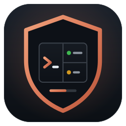

<p align="center"></p>

# Securidge KMttt — Trusted Terminal Tracker

> **개인 프로젝트입니다.** KMttt는 **김광모(Kwangmo Kim)**가 개인적으로 만드는 오픈소스 프로젝트이며, 어떤 회사나 소속 기관의 제품이 아니고 그 기관이 보증하지도 않습니다.

AI 코딩 에이전트용 터미널 멀티플렉서입니다. 보안 통제가 기본으로 들어 있고, 돌리는 모든 에이전트를 한 화면에서 관제합니다.

에이전트(Claude Code, Codex CLI, OpenCode, Cursor CLI, Copilot CLI, Gemini CLI, Aider, 일반 셸)마다 **실제 터미널 창(pane)**을 하나씩 줍니다. 백그라운드 서버가 창을 소유하면서 각 에이전트가 무엇을 하는지 감지합니다. 창 사이의 모든 동작은 정책 관문, 비밀정보 마스킹, 위변조 탐지 감사 로그를 거칩니다.

[English README](README.md) · [설계서](docs/DESIGN.md) · [결정 기록](docs/DECISIONS.md) · [보안 정책](SECURITY.md) · [데스크톱 사용 가이드](docs/USER_GUIDE.ko.md) · [코드 서명 정책](#코드-서명-정책-code-signing-policy) · [변경 내역](CHANGELOG.md) · [♥ 후원하기](https://github.com/sponsors/kkmkkmzz)

KMttt가 도움이 되었다면 [개발을 후원](https://github.com/sponsors/kkmkkmzz)해 주세요. KMttt는 계속 무료이며 후원은 자발적입니다.

## 하는 일

**멀티플렉서.** 세션 › 워크스페이스 › 탭 › 창 구조이고, ID는 `w1`, `w1:t1`, `w1:p2` 형식이며 에이전트 이름을 별칭으로 씁니다. 분리·재접속(`ctrl+b q`), 마우스 선택·스크롤·경계선 끌어 크기 조절, 재시작 후 레이아웃 복원, git worktree 워크스페이스, 플러그인, SSH 원격을 지원합니다.

**에이전트 상태 감지.** 다섯 상태(`working`, `blocked`, `done`, `idle`, `unknown`)를 전면 프로세스와 화면 아래쪽으로 판단합니다. 판단 규칙은 바꿔 끼울 수 있는 TOML 매니페스트입니다. 훅 신호가 있으면 화면 추정보다 우선하고, `kmttt agent explain`으로 근거를 볼 수 있습니다.

**보안 통제**

| | 통제 | 하는 일 |
| --- | --- | --- |
| F1 | 정책 관문 | 모든 API 호출을 호출한 프로세스와 연결합니다. 한 창의 에이전트가 다른 창에 입력하거나, 읽거나, 조작하려 하면 먼저 사람에게 묻습니다(`allow`/`deny`/`ask`, 속도 제한, 프롬프트 인젝션 패턴). 승인은 사람만 할 수 있습니다. |
| F2 | 기록 | 세션마다 추가 전용 JSONL에 SHA-256 해시 체인과 Ed25519 서명 체크포인트를 남깁니다. `kmttt audit verify`로 서버 없이 검증하며, 파일이나 syslog로 사본을 보낼 수 있습니다. |
| F3 | 마스킹 | 내장 비밀 규칙 20종과 엔트로피 검사를 씁니다. 한 번 잡은 값과 서버 환경 변수 중 비밀로 보이는 값도 배웁니다. `pane read`, 기록, 저장 이력은 항상 마스킹됩니다. |
| F4 | 격리 | 창마다 프로필을 고릅니다: `none`, `restricted`(Linux Landlock, macOS `sandbox-exec`, Windows Job Object 제한), `container`(docker/podman), `wsl`. `restricted`에서는 외부 TCP 연결을 허용 목록 프록시로만 보냅니다(Linux 6.7+, macOS). |
| F5 | 훅 | Claude Code `PreToolUse` 훅으로 위험한 도구 호출(`rm -rf /`, `curl … \| sh`, force-push, `.env`·SSH 키 읽기 등)을 막습니다. Codex `notify`는 관찰만 합니다. |

**관제 센터**(`ctrl+b d` 또는 `kmttt --control`): 모든 머신의 모든 에이전트를 상태, 격리 수준, 차단 건수, CPU·메모리와 함께 보여 줍니다. 승인 대기열, 보안 이벤트, 에이전트 간 메시지, 도구 호출, 기록 무결성도 한 화면에 있습니다. `kmttt console`은 같은 화면을 로컬 웹 페이지로 엽니다(127.0.0.1 전용, 무작위 토큰, `--allow-actions` 없이는 읽기 전용).

## 설치

[Releases](https://github.com/securidge/securidge-kmttt/releases)에서 Windows·macOS·Linux용 서명된 실행 파일을 받으세요([내려받은 파일 확인](#내려받은-파일-확인) 참고). 소스로 빌드할 수도 있습니다(Rust 1.97 이상).

```sh
git clone https://github.com/securidge/securidge-kmttt
cd securidge-kmttt
cargo build --release -p kmttt
# target/release/kmttt(Windows는 kmttt.exe)를 PATH에 둔다
```

## 데스크톱 앱 (창 화면)

키 조합을 외우지 않고 마우스로 쓰고 싶다면 **KMttt Desktop**을 쓰세요. 같은 서버에 붙는 창 프로그램이라, 터미널(TUI)·CLI와 함께 써도 됩니다. 보안 판단(승인·기록·민감정보 마스킹·격리 수준)은 모두 서버가 하므로 어느 화면에서 하든 같습니다.

**→ 자세한 사용법은 [KMttt Desktop 사용 가이드](docs/USER_GUIDE.ko.md)를 보세요.** (설치, 화면 둘러보기, 승인, AI 사용량, 설정, 단축키, 용어, 문제 해결, 제거)


- **설치**: Releases에서 `kmttt-desktop-windows-x86_64-setup.exe`를 받으세요. `kmttt.exe`가 함께 들어 있습니다. 설치 첫 화면에서 **개인·비상업 프로젝트 고지**를 보여 줍니다. 관리자 권한 없이 내 계정에만 설치됩니다. Linux는 `.deb`, macOS는 `.app.zip`입니다.
- **처음 켜면** 네 단계 안내(언어 → 격리 수준 → 프로젝트 폴더 → 첫 AI 에이전트)가 나옵니다.
- **AI 사용량**: 왼쪽 아래에 Claude Code·Codex의 **남은 양(%)과 "4시간 30분 후 토큰 초기화" 같은 카운트다운**을 보여 줍니다. Claude는 한 번 [연결하기]가 필요하고 Pro·Max 요금제에서만 나옵니다([가이드 7장](docs/USER_GUIDE.ko.md#7-ai-사용량-남은-양과-초기화까지-남은-시간)).
- **도움말**: `F1` 또는 [? 가이드]에 시작하기·작업별 안내·단축키·용어집·정보와 제거가 있습니다. 화면 위 💡 줄이 지금 할 일을 한 줄로 알려 줍니다.
- **명령 팔레트**: `Ctrl+Shift+P`에 "나누기", "승인", "사용량"처럼 하고 싶은 일을 입력하세요.
- **제거**: Windows 설정 → 앱 → KMttt Desktop → 제거. 서버를 끄고, 이 설치본이 Claude·Codex에 등록한 훅·상태 줄을 지우고(원래 Claude 상태 줄과 보관해 둔 Codex `notify`는 되돌림), 설정·감사 로그를 지울지 묻습니다(기본: 남김).

| 하고 싶은 일 | 이렇게 하세요 |
| --- | --- |
| 프로젝트 열기 | [새 워크스페이스] → 폴더 고르기 → 격리 수준 고르기 |
| AI 에이전트 띄우기 | [에이전트 실행] → Claude Code·Codex 등 고르기 |
| 화면 나누기·크기 조절 | [오른쪽으로 분할]·[아래쪽으로 분할], 경계선 끌기 |
| 승인 요청에 답하기 | 위쪽 알림 막대의 [보기] → [이번만 허용]/[거부] |
| 모든 에이전트 보기 | [통합 관제] 탭 |
| 보안 정책·격리 수준 바꾸기 | [⚙ 설정] → [보안 정책]·[격리 수준] → [저장] (보안이 약해지는 변경은 한 번 더 묻습니다) |
| 복사·붙여넣기 | 끌어서 선택 → `Ctrl+Shift+C` / `Ctrl+Shift+V`(Windows는 `Ctrl+V`도), 또는 오른쪽 클릭 |

데스크톱 앱의 보안 설계는 [결정 기록 D23~D26](docs/DECISIONS.md)과 [보안 점검 결과](docs/SECURITY-REVIEW.md)에 있습니다. 요약하면: 웹뷰는 앱에 들어 있는 화면 파일만 읽고(외부 주소 금지), 서버 기능은 허용 목록에 있는 것만 부를 수 있습니다. 창 안이나 자동화 도구로 띄운 데스크톱 앱은 서버가 연결을 거부합니다.

## 빠른 시작

```sh
kmttt                          # 서버가 없으면 띄우고 붙는다
# 안에서: ctrl+b v 오른쪽 분할 · ctrl+b - 아래 분할 · ctrl+b ? 전체 키
#         ctrl+b d 관제 센터 · ctrl+b a 승인 대기열 · ctrl+b q 분리

kmttt integration install claude   # Claude Code 도구 호출을 보고 통제
kmttt policy init                  # 주석이 달린 policy.toml 만들기
```

스크립트로 다루거나, 한 에이전트가 다른 에이전트들을 지휘하게 할 수도 있습니다(단계마다 정책 관문을 거칩니다).

```sh
kmttt workspace create --label api
kmttt pane split w1:p1 --direction right          # 새 pane ID 출력
kmttt agent start reviewer --kind claude --pane w1:p2
kmttt agent prompt reviewer "review the last commit" --wait --timeout 600000
kmttt agent explain reviewer
kmttt approval list && kmttt approval allow 3
kmttt events --kind agent.state --kind security.event   # 줄마다 JSON 이벤트 하나
```

원격 머신:

```sh
kmttt --remote alice@build-box             # 원격 서버에 붙기
kmttt --remote alice@build-box pane list   # API 명령을 SSH 너머로
kmttt machine add alice@build-box --label build-box   # 관제 센터에 표시
```

모든 명령은 JSON을 출력합니다. 종료 코드는 `0` 성공, `1` 오류, `2` 대상 없음·잘못된 입력, `3` 정책 거부, `4` 시간 초과, `5` 기록 검증 실패입니다. `kmttt schema`는 소켓 API의 OpenRPC 문서를 출력합니다.

## 에이전트 스킬 (Claude Code·Codex)

KMttt 창 안에서 일하는 방법을 Claude Code와 Codex에게 알려 주는 에이전트 스킬을 제공합니다. 다른 에이전트에게 승인 한 번으로 메시지 보내기, 답을 기다리고 화면 읽기, 승인·거부·격리된 창의 외부 통신 차단을 우회하지 않고 처리하는 방법이 들어 있습니다.

- **자동**: Claude Code(KMttt Desktop의 [에이전트 → Claude 사용량 연동…] 또는 `kmttt integration install claude`)나 Codex(`kmttt integration install codex`)를 연동하면 스킬도 함께 설치되고, 연동 해제·프로그램 제거 때 함께 지워집니다.
- **Claude Code**: `/plugin marketplace add securidge/securidge-kmttt` 실행 후 `/plugin install kmttt@securidge`
- **Codex**: [`plugins/kmttt/skills/kmttt`](plugins/kmttt/skills/kmttt) 폴더를 `~/.agents/skills/kmttt`(또는 저장소의 `.agents/skills/kmttt`)에 복사
- **SKILL.md를 읽는 그 밖의 도구**: `npx skills add securidge/securidge-kmttt`

**기존 Codex 알림:** `kmttt integration install codex`는 다른 `notify` 설정이 이미 있으면 기본적으로 덮어쓰기를 거부합니다. 보관 후 교체하려면 `kmttt integration install codex --replace`를 실행하세요. KMttt 연동 중에는 기존 알림 실행이 중단되며, Codex 앱의 computer-use처럼 해당 알림에 의존하는 기능도 중단될 수 있습니다. `kmttt integration uninstall codex`로 연동을 해제하면 보관한 알림을 복원합니다. 단, 설치된 KMttt `notify`를 직접 다른 값으로 바꿨다면 현재 설정과 보관한 알림은 그대로 둡니다.

기존 알림을 계속 호출하려면 `--replace` 대신 `kmttt integration install codex --chain`을 명시적으로 선택하세요. 먼저 KMttt 보고를 최대 1초 동안 시도한 뒤, 등록된 이전 알림을 별도로 최대 3초 동안 호출합니다. 설치 시 경로를 확인하고 등록한 네이티브 실행 파일만 셸 해석 없이 실행하며, 셸과 스크립트·`.cmd`/`.bat` 파일을 알림 프로그램으로 직접 지정하면 거부합니다(Windows는 네이티브 `.exe` 필요). 두 모드 모두 올바른 TOML이 필요하고, 원래 설정을 보관해 해제 시 복원하며, 함께 지정할 수 없습니다.

## 파일 위치

| | Linux / macOS | Windows |
| --- | --- | --- |
| `config.toml`, `policy.toml` | `~/.config/kmttt/` | `%APPDATA%\Securidge\kmttt\` |
| 기록, 세션, 로그 | `~/.local/share/kmttt/` | `%LOCALAPPDATA%\Securidge\kmttt\` |

`kmttt server reload-config`는 재시작 없이 바꾼 설정을 적용합니다. `kmttt uninstall`은 훅, 설정, 저장된 세션을 지웁니다. 기록은 `--purge-ledger`를 줄 때만 지웁니다.

## 보안 모델

**어떤 프로필이 무엇을 막는지.** 승인 관문(F1)은 호출한 프로세스를 식별하는 방식으로 동작합니다. 그래서 속거나 프롬프트 인젝션을 당해 다른 창을 조작하려는 에이전트를 확실히 막습니다. 창에서 빠져나간 경우(`( kmttt … & )`, `setsid`, `KMTTT_PANE` 지우기)도 마찬가지입니다. 식별 방법은 OS마다 다릅니다: Linux는 child subreaper, Windows는 창별 Job Object, macOS는 launchd 고아 검사를 씁니다.

**하지만 같은 OS 사용자 권한으로 `none` 프로필에서 돌면서 KMttt를 일부러 공격하는 에이전트는 가둘 수 없습니다.** 이런 에이전트는 OS 서비스를 거쳐 이 컴퓨터에 다시 들어와 사람처럼 행동할 수 있고(`ssh localhost`, `systemd-run`, WMI, 새 터미널 창 등), 설정 파일도 고칠 수 있습니다. 예를 들어 `ssh localhost`로 다시 들어와 자기 요청을 스스로 승인할 수 있습니다. 이때도 기록에는 결정한 프로세스 계보(`sshd`)가 남습니다.

믿지 못하는 에이전트는 격리 프로필로 돌리세요.

| 프로필 | SSH·네트워크로 우회 | KMttt 설정·기록 수정 | 로컬 IPC 서비스(예: `systemd-run`) |
| --- | --- | --- | --- |
| `none` | 가능 | 가능 | 가능 |
| `restricted`, Linux 6.7+ | **차단**(TCP는 이그레스 프록시로만) | **차단** | 가능 — Landlock은 Unix 소켓 연결을 막지 못함 |
| `restricted`, macOS | **차단**(sandbox 프로필) | **차단** | 가능 |
| `container` | 컨테이너 네트워크 설정에 따름 | 차단(프로젝트 폴더만 마운트) | 차단 — KMttt 소켓이 마운트되지 않음 |

알아 둘 동작:

- **Windows에서 서비스 밑에서 도는 자동화(CI 러너, 작업 스케줄러)는 에이전트로 봅니다.** 사람으로 보게 하려면 `policy.toml`에 그 실행자를 적으세요(`[identify] trusted_launchers = ["Runner.Listener"]`).
- **에이전트가 질문을 띄운 상태(blocked)에서는 `agent prompt`가 입력을 거부합니다.** 그대로 보내면 글자와 Enter가 그 질문의 답이 되기 때문입니다. `kmttt pane send`로 답하거나 `--force`를 쓰세요.
- **창 안에서 사람이 `kmttt`를 실행해도 에이전트로 봅니다.** 승인은 KMttt 바깥 터미널, TUI 승인 패널, 웹 콘솔에서 하세요.
- **`container`의 외부 통신 허용 목록은 권고 수준입니다.** 기본 `bridge` 네트워크에서는 직접 나갈 수 있고, Linux의 일반 Docker에서는 컨테이너가 호스트 프록시에 닿지 못합니다. `restricted`는 Linux 6.7 이상과 macOS에서 실제로 막으며, 그보다 오래된 Linux 커널에서는 막지 못한다고 경고합니다.
- **Windows `restricted`는 메모리와 프로세스 수만 제한합니다.** 파일 시스템은 막지 않으며 `kmttt`는 강도를 `low`로 표시합니다. 대신 `wsl`이나 `container`를 쓰세요.
- **상태 감지는 에이전트별 화면 규칙(매니페스트)을 씁니다.** 에이전트 UI가 바뀌면 매니페스트를 고치면 됩니다(`kmttt server agent-manifests`).
- **규칙에 없는 비밀 형식은 마스킹이 잡지 못합니다.** 에이전트가 자기 회사 서버로 보내는 내용도 통제하지 않습니다.

## 내려받은 파일 확인

`SHA256SUMS.txt`에 모든 릴리스 파일의 SHA-256이 있고, 이 목록이 [minisign](https://jedisct1.github.io/minisign/)으로 서명돼 있습니다(`SHA256SUMS.txt.minisig`). 공개키는 [`assets/release/minisign.pub`](assets/release/minisign.pub)에 있습니다.

```
RWSsN6lcjx/Hn8RG/c/tAQnOC1Xk3A2fOCuRT5mhX7LwEZzT9nYuU80E
```

```sh
minisign -Vm SHA256SUMS.txt -P RWSsN6lcjx/Hn8RG/c/tAQnOC1Xk3A2fOCuRT5mhX7LwEZzT9nYuU80E
sha256sum -c --ignore-missing SHA256SUMS.txt
```

Windows에서는 `Get-FileHash <파일>`로 나온 값을 `SHA256SUMS.txt`의 줄과 비교하세요. `kmttt update`도 스스로 같은 검사를 하며, 서명이나 해시가 맞지 않으면 설치하지 않습니다.

## 코드 서명 정책 (Code signing policy)

- **빌드**: 모든 릴리스 파일은 이 저장소의 소스에서 GitHub Actions(`.github/workflows/release.yml`)가 만듭니다.
- **minisign**: 모든 릴리스 파일의 해시를 담은 `SHA256SUMS.txt`를 프로젝트의 minisign 키로 서명합니다([내려받은 파일 확인](#내려받은-파일-확인)).
- **Windows 코드 서명**: Free code signing provided by [SignPath.io](https://signpath.io), certificate by [SignPath Foundation](https://signpath.org). SignPath Foundation 서명이 붙은 Windows 파일에 해당하며, 그 파일의 게시자는 "SignPath Foundation"으로 표시됩니다.
- **역할**: 작성자·검토자(Committers and reviewers) — [김광모(@kkmkkmzz)](https://github.com/kkmkkmzz). 승인자(Approvers) — [김광모(@kkmkkmzz)](https://github.com/kkmkkmzz). 서명 요청은 릴리스마다 승인자가 직접 승인합니다.
- **개인정보(Privacy policy)**: 이 프로그램은 사용자나 설치·운영하는 사람이 직접 요청한 경우가 아니면 다른 네트워크 시스템으로 어떤 정보도 보내지 않습니다. 텔레메트리가 없습니다. 네트워크를 쓰는 기능은 사용자가 실행한 것뿐입니다(`kmttt update`, 플러그인 설치, SSH 원격, 웹 콘솔). KMttt 안에서 돌리는 AI 에이전트(Claude Code, Codex 등)는 별개의 프로그램이며 각자의 개인정보 처리방침을 따릅니다.
- **제거**: [사용 가이드 13장](docs/USER_GUIDE.ko.md#13-제거하기)에 제거 방법이 있습니다.

## 취약점 신고

[SECURITY.md](SECURITY.md)를 보세요.

## 라이선스

이중 라이선스입니다. 아래 두 라이선스 중 하나를 골라 따르면 됩니다.

- [MIT 라이선스](LICENSE-MIT)
- [Apache 라이선스 2.0](LICENSE-APACHE)

개인 프로젝트 · 만든 사람 김광모(Kwangmo Kim)
