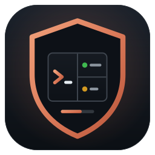

<p align="center"></p>

# Securidge KMttt — Trusted Terminal Tracker

> **Personal project.** KMttt is a personal open-source project by **Kwangmo Kim (김광모)**. It is not a product of, or endorsed by, any company or employer.

A terminal multiplexer for AI coding agents, with security controls built in and one screen to watch every agent you run.

KMttt gives each agent (Claude Code, Codex CLI, OpenCode, Cursor CLI, Copilot CLI, Gemini CLI, Aider, or a plain shell) its own **real terminal pane**. A background server owns the panes, detects what each agent is doing, and routes every pane-to-pane action through a policy gate, a secret redactor and a tamper-evident ledger.

[한국어 README](README.ko.md) · [Design](docs/DESIGN.md) · [Decisions](docs/DECISIONS.md) · [Security policy](SECURITY.md) · [Desktop user guide](docs/USER_GUIDE.md) · [Code signing policy](#code-signing-policy) · [Changelog](CHANGELOG.md) · [♥ Sponsor](https://github.com/sponsors/kkmkkmzz)

If KMttt helps you, consider [sponsoring its development](https://github.com/sponsors/kkmkkmzz). KMttt stays free; sponsoring is voluntary.

## What it does

**Multiplexer.** Session › workspace › tab › pane, with IDs such as `w1`, `w1:t1`, `w1:p2` and agent names as aliases. Detach and attach (`ctrl+b q`), mouse focus, scrolling and border-drag resize, layout restore after a restart, git worktree workspaces, plugins and SSH remotes.

**Agent awareness.** Five states (`working`, `blocked`, `done`, `idle`, `unknown`), worked out from the foreground process and the bottom of the screen using TOML manifests that you can replace. Hook signals override screen guesses. `kmttt agent explain` shows the evidence behind a state.

**Security controls**

| | Control | What it does |
| --- | --- | --- |
| F1 | Policy gate | Every API call is tied to the calling process. When an agent in one pane tries to type into, read or control another pane, KMttt asks a person first (`allow` / `deny` / `ask`, rate limits, prompt-injection patterns). Only a person can approve. |
| F2 | Ledger | Append-only JSONL with a SHA-256 hash chain and Ed25519-signed checkpoints, one per session. `kmttt audit verify` checks it offline. It can also mirror to a file or syslog. |
| F3 | Redaction | Twenty built-in secret rules plus an entropy check. It also learns values it has already caught and secret-looking server environment variables. `pane read`, the ledger and saved history are always redacted. |
| F4 | Sandbox | Per-pane profiles: `none`, `restricted` (Landlock on Linux, `sandbox-exec` on macOS, Job Object limits on Windows), `container` (docker/podman), `wsl`. In `restricted`, outbound TCP can reach only an allowlist proxy (Linux 6.7+, macOS). |
| F5 | Hooks | Claude Code `PreToolUse` hooks can block dangerous tool calls (`rm -rf /`, `curl … \| sh`, force-push, reading `.env` or SSH keys, …). Codex `notify` is observe-only. |

**Control Center** (`ctrl+b d` or `kmttt --control`): every agent on every machine with state, sandbox, blocked count, CPU and memory, plus the approval queue, security events, agent-to-agent messages, tool calls and ledger integrity on one screen. `kmttt console` serves the same view as a local web page (127.0.0.1 only, random token, read-only unless you pass `--allow-actions`).

## Install

Download a signed binary for Windows, macOS or Linux from [Releases](https://github.com/securidge/securidge-kmttt/releases) (see [Verifying a download](#verifying-a-download)), or build from source (Rust 1.97 or newer):

```sh
git clone https://github.com/securidge/securidge-kmttt
cd securidge-kmttt
cargo build --release -p kmttt
# put target/release/kmttt (kmttt.exe on Windows) on your PATH
```

## Desktop app (window GUI)

If you would rather click than learn key bindings, use **KMttt Desktop**. It is a window app that connects to the same server, so you can use it alongside the terminal UI and the CLI. Every security decision (approvals, log, masking, protection) is still made by the server.

**→ Full instructions: [KMttt Desktop user guide](docs/USER_GUIDE.md)** (install, tour, approvals, AI usage, settings, shortcuts, glossary, troubleshooting, uninstall)


- **Install**: from Releases, get `kmttt-desktop-windows-x86_64-setup.exe`. It ships with `kmttt.exe`. The installer opens with a **personal, non-commercial project notice** and installs for your account only (no admin rights). Linux: `.deb`; macOS: `.app.zip`.
- **First run** walks you through four steps (language → isolation level → project folder → first AI agent).
- **AI usage**: the bottom-left panel shows how much Claude Code and Codex usage is **left (%) and a reset countdown** ("Resets in 4h 30m"). Claude needs a one-time [Connect] and works on Pro/Max plans only ([guide section 7](docs/USER_GUIDE.md#7-ai-usage-what-is-left-and-when-it-resets)).
- **Help**: `F1` or [? Guide] has getting started, how-tos, shortcuts, a glossary, and about/uninstall. The 💡 line tells you what to do next.
- **Command palette**: press `Ctrl+Shift+P` and type what you want to do ("split", "approve", "usage").
- **Uninstall**: Windows Settings → Apps → KMttt Desktop → Uninstall. It stops the server, removes the hooks and status line this copy registered in Claude/Codex (restoring your own status line), and asks whether to delete settings and the audit log (default: keep).

| To do this | Do this |
| --- | --- |
| Open a project | [+ New workspace] → pick a folder → pick a isolation level |
| Launch an agent | [Launch agent] → pick Claude Code, Codex, … |
| Split and resize | [Split left/right] / [Split top/bottom], drag the line between panes |
| Answer an approval | [View] on the approval banner → [Allow] / [Deny] |
| See every agent | [Control center] tab |
| Change the security policy or isolation | [⚙ Settings] → [Security policy] / [Isolation] → [Save] (changes that weaken security ask again) |
| Copy and paste | Drag to select → `Ctrl+Shift+C` / `Ctrl+Shift+V` (also `Ctrl+V` on Windows), or right-click |

The desktop app's security design is in [decisions D23–D26](docs/DECISIONS.md) and the [security review](docs/SECURITY-REVIEW.md). In short: the webview only loads the screens built into the app (no remote content), and it can call only an allow-listed set of server methods. A desktop app started inside a pane or by an automation tool is refused by the server.

## Quick start

```sh
kmttt                          # start the server if needed and attach
# inside: ctrl+b v  split right · ctrl+b -  split down · ctrl+b ?  all keys
#         ctrl+b d  Control Center · ctrl+b a  approvals · ctrl+b q  detach

kmttt integration install claude   # let KMttt see and gate Claude Code tool calls
kmttt policy init                  # write a commented policy.toml you can edit
```

Drive it from scripts, or let one agent orchestrate others (each step goes through the policy gate):

```sh
kmttt workspace create --label api
kmttt pane split w1:p1 --direction right          # prints the new pane id
kmttt agent start reviewer --kind claude --pane w1:p2
kmttt agent prompt reviewer "review the last commit" --wait --timeout 600000
kmttt agent explain reviewer
kmttt approval list && kmttt approval allow 3
kmttt events --kind agent.state --kind security.event   # one JSON event per line
```

Remote machines:

```sh
kmttt --remote alice@build-box             # attach to the server over there
kmttt --remote alice@build-box pane list   # any API command, over SSH
kmttt machine add alice@build-box --label build-box   # show it in the Control Center
```

Every command prints JSON. Exit codes: `0` ok, `1` error, `2` not found or bad input, `3` denied by policy, `4` timeout, `5` ledger verification failed. `kmttt schema` prints the OpenRPC description of the socket API.

## Agent skill (Claude Code and Codex)

KMttt ships an agent skill that teaches Claude Code and Codex how to work inside KMttt panes: message another agent with a single approval, wait for and read its screen, and handle approvals, denials and sandbox network blocks without working around them.

- **Automatic**: connecting Claude Code or Codex to KMttt (KMttt Desktop: Agent → Connect Claude usage, or `kmttt integration install claude|codex`) installs the skill too, and disconnecting or uninstalling removes it.
- **Claude Code**: `/plugin marketplace add securidge/securidge-kmttt`, then `/plugin install kmttt@securidge`
- **Codex**: copy [`plugins/kmttt/skills/kmttt`](plugins/kmttt/skills/kmttt) to `~/.agents/skills/kmttt` (or a repository's `.agents/skills/kmttt`)
- **Other tools that read `SKILL.md`**: `npx skills add securidge/securidge-kmttt`

**Existing Codex notifications:** `kmttt integration install codex` refuses to overwrite another `notify` setting by default. To save and replace it, run `kmttt integration install codex --replace`. This disables the previous notifier while the KMttt integration is installed; features that depend on it (such as computer use in the Codex app) may stop until you remove the integration with `kmttt integration uninstall codex`. Removal restores the saved notifier if KMttt's installed `notify` is still present; if you have replaced it yourself, your current setting and the saved notifier are left unchanged.

To keep calling the previous notifier, explicitly opt in with `kmttt integration install codex --chain` instead of `--replace`. KMttt reporting is attempted first with a 1-second limit, then the registered previous notifier is called with a separate 3-second limit. Only the native executable resolved and registered at installation is used, without shell interpretation; shells and scripts, including `.cmd`/`.bat` files, are rejected as the notifier program (Windows requires a native `.exe`). Both modes require valid TOML, save the original setting for restoration on uninstall, and cannot be combined.

## Files

| | Linux / macOS | Windows |
| --- | --- | --- |
| `config.toml`, `policy.toml` | `~/.config/kmttt/` | `%APPDATA%\Securidge\kmttt\` |
| ledger, sessions, logs | `~/.local/share/kmttt/` | `%LOCALAPPDATA%\Securidge\kmttt\` |

`kmttt server reload-config` applies changes without restarting. `kmttt uninstall` removes hooks, config and saved sessions. It keeps the ledger unless you pass `--purge-ledger`.

## Security model

**Which profile protects you from what.** The approval gate (F1) works by identifying the calling process. That reliably stops an agent that was tricked or prompt-injected into driving another pane, including one that detaches from its pane (`( kmttt … & )`, `setsid`, clearing `KMTTT_PANE`). Each OS uses a different method: a child subreaper on Linux, per-pane Job Objects on Windows, and a launchd-orphan check on macOS.

**An agent that deliberately attacks KMttt while running as your own OS user, in the `none` profile, is not contained.** It can reach your machine again through an OS service, for example `ssh localhost`, `systemd-run`, WMI or a new terminal window, and act as you. It can also edit your config files. For example, it can come back over `ssh localhost` and approve its own request. The ledger still records the decision's process lineage (`sshd`).

For agents you don't trust, use a sandbox profile:

| Profile | Escape over SSH / network | Edit KMttt config or ledger | Local IPC services (e.g. `systemd-run`) |
| --- | --- | --- | --- |
| `none` | possible | possible | possible |
| `restricted`, Linux 6.7+ | **blocked** (TCP limited to the egress proxy) | **blocked** | possible: Landlock cannot restrict Unix socket connections |
| `restricted`, macOS | **blocked** (sandbox profile) | **blocked** | possible |
| `container` | depends on the container network | blocked (only the project folder is mounted) | blocked: the KMttt socket is not mounted |

Things to know:

- **On Windows, automation that runs under a service (CI runners, Task Scheduler) counts as an agent** unless you list its launcher in `policy.toml` (`[identify] trusted_launchers = ["Runner.Listener"]`).
- **`agent prompt` refuses to type into an agent that is asking a question** (blocked), because the text and Enter would become the answer. Answer with `kmttt pane send`, or pass `--force`.
- **A person running `kmttt` inside a pane counts as an agent.** Approve from a terminal outside KMttt, from the TUI's approval panel, or from the web console.
- **The `container` egress allowlist is advisory.** The container's default `bridge` network can connect directly, and on native Linux Docker the host proxy is not reachable from the container. In `restricted` on Linux 6.7+ and macOS, egress is enforced. On older Linux kernels KMttt warns that it is not.
- **Windows `restricted` only limits memory and process count.** It does not restrict the file system, and `kmttt` reports its strength as `low`. Use `wsl` or `container` instead.
- **State detection uses a screen rule file (manifest) per agent.** When an agent changes its UI, edit its manifest (`kmttt server agent-manifests` lists them).
- **Redaction cannot catch a secret format it has no rule for**, and it does not control what an agent sends to its own vendor.

## Verifying a download

`SHA256SUMS.txt` lists the SHA-256 of every release file and is signed with [minisign](https://jedisct1.github.io/minisign/) (`SHA256SUMS.txt.minisig`). The public key is in [`assets/release/minisign.pub`](assets/release/minisign.pub):

```
RWSsN6lcjx/Hn8RG/c/tAQnOC1Xk3A2fOCuRT5mhX7LwEZzT9nYuU80E
```

```sh
minisign -Vm SHA256SUMS.txt -P RWSsN6lcjx/Hn8RG/c/tAQnOC1Xk3A2fOCuRT5mhX7LwEZzT9nYuU80E
sha256sum -c --ignore-missing SHA256SUMS.txt
```

On Windows: `Get-FileHash <file>` and compare with the line in `SHA256SUMS.txt`. `kmttt update` performs the same check by itself and refuses to install a file whose signature or hash does not match.

## Code signing policy

- **Build**: every release file is built from the source in this repository by GitHub Actions (`.github/workflows/release.yml`).
- **minisign**: `SHA256SUMS.txt`, which lists the hash of every release file, is signed with the project's minisign key ([Verifying a download](#verifying-a-download)).
- **Windows code signing**: Free code signing provided by [SignPath.io](https://signpath.io), certificate by [SignPath Foundation](https://signpath.org). This applies to Windows files that carry a SignPath Foundation signature; their publisher is shown as "SignPath Foundation".
- **Roles**: Committers and reviewers — [Kwangmo Kim (@kkmkkmzz)](https://github.com/kkmkkmzz). Approvers — [Kwangmo Kim (@kkmkkmzz)](https://github.com/kkmkkmzz). Each signing request is approved by an approver for every release.
- **Privacy policy**: This program will not transfer any information to other networked systems unless specifically requested by the user or the person installing or operating it. There is no telemetry. The only features that use the network are ones you run yourself (`kmttt update`, plugin install, SSH remotes, the local web console). The AI agents you run inside KMttt (Claude Code, Codex, …) are separate programs with their own privacy policies.
- **Uninstall**: see [section 13 of the user guide](docs/USER_GUIDE.md#13-uninstall).

## Reporting a vulnerability

See [SECURITY.md](SECURITY.md).

## License

MIT OR Apache-2.0, at your option.

Made by Kwangmo Kim (김광모) as a personal project.
