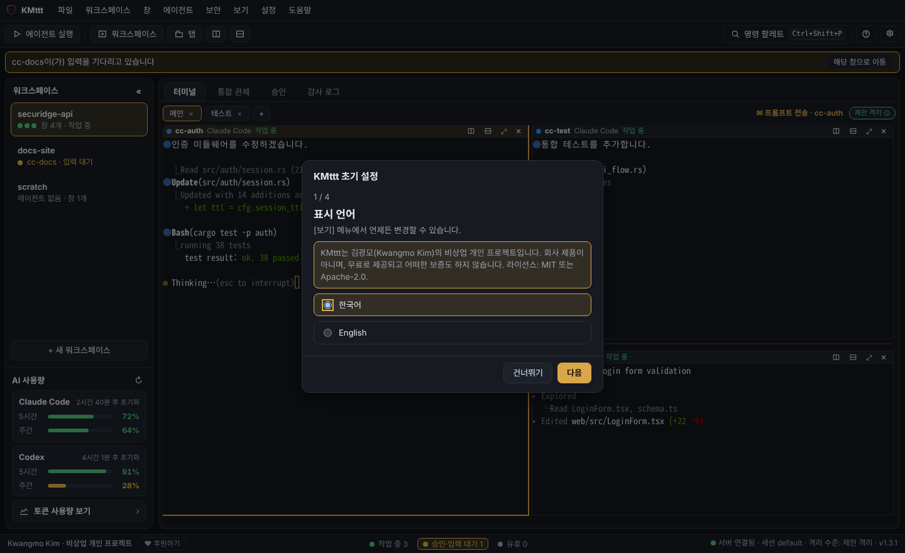
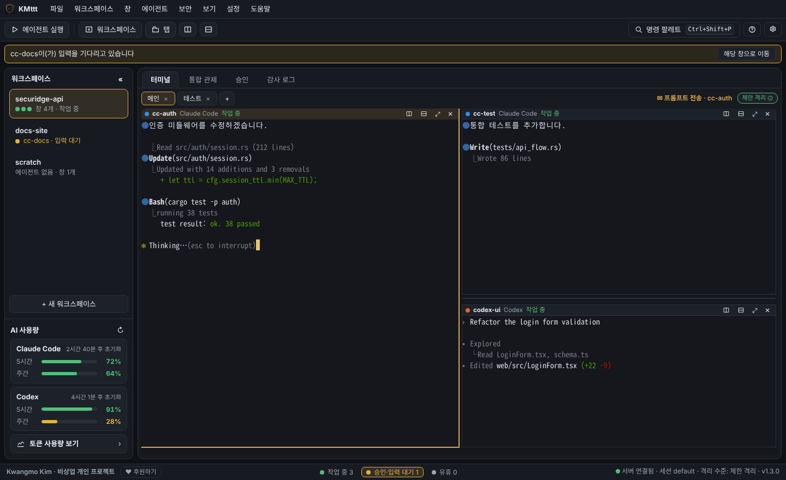
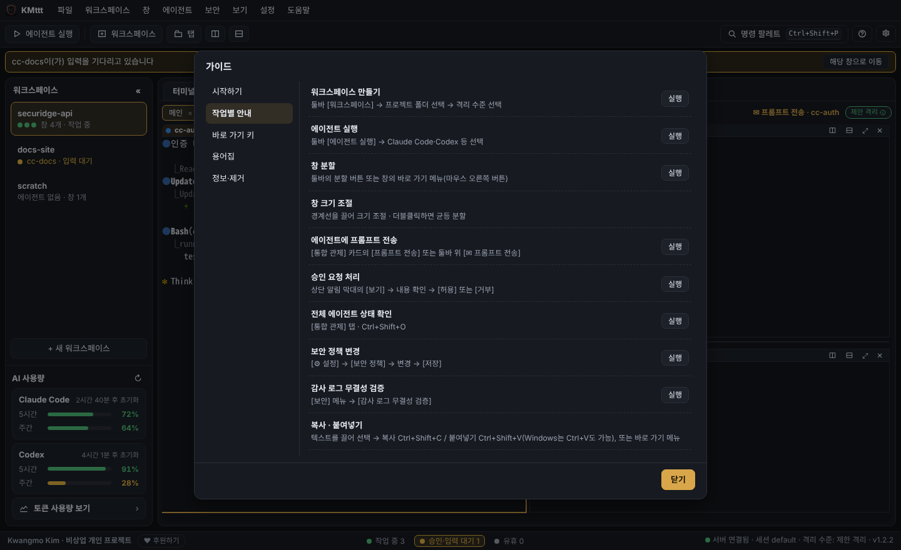
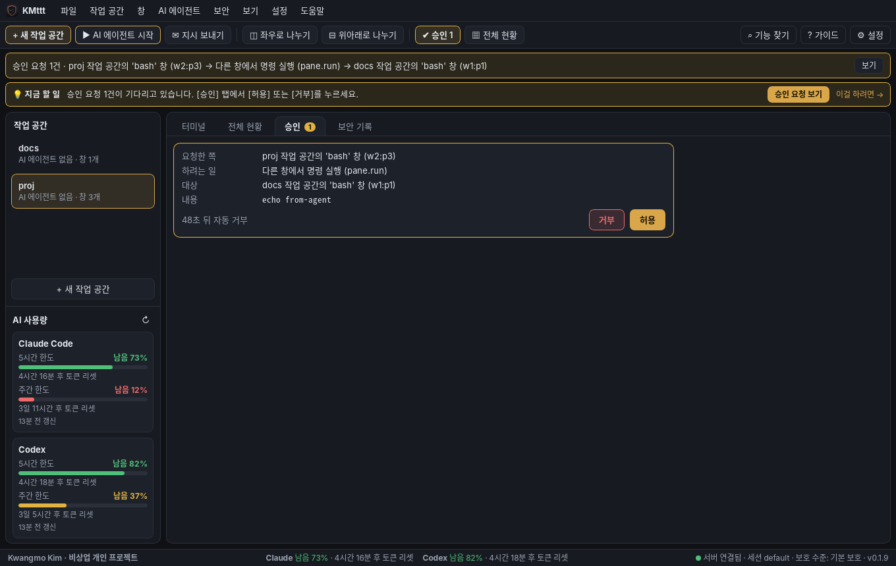
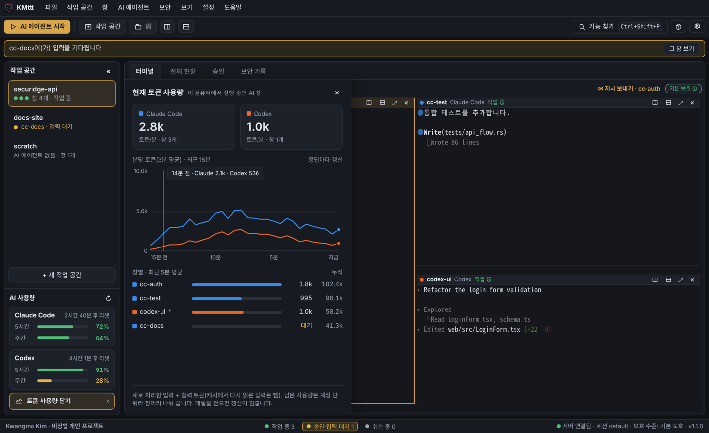
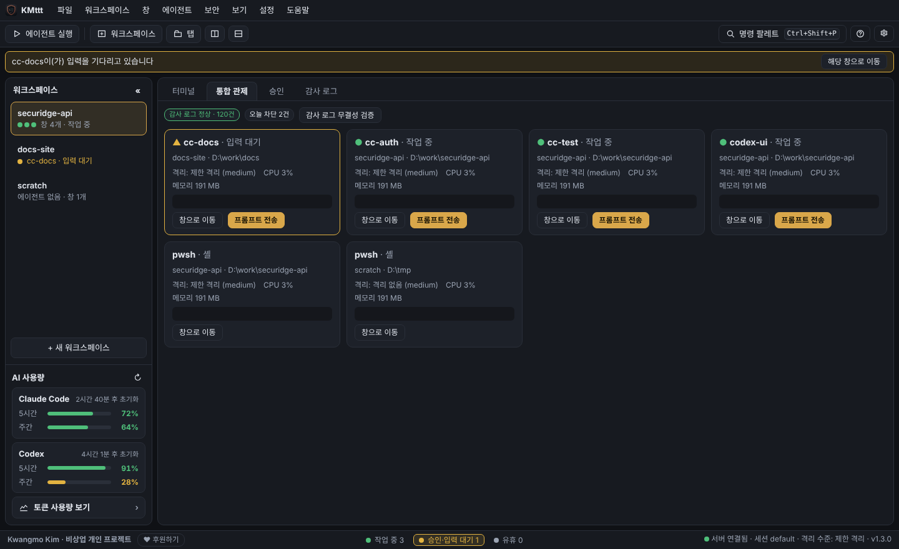
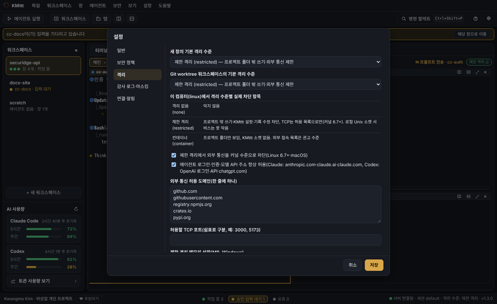
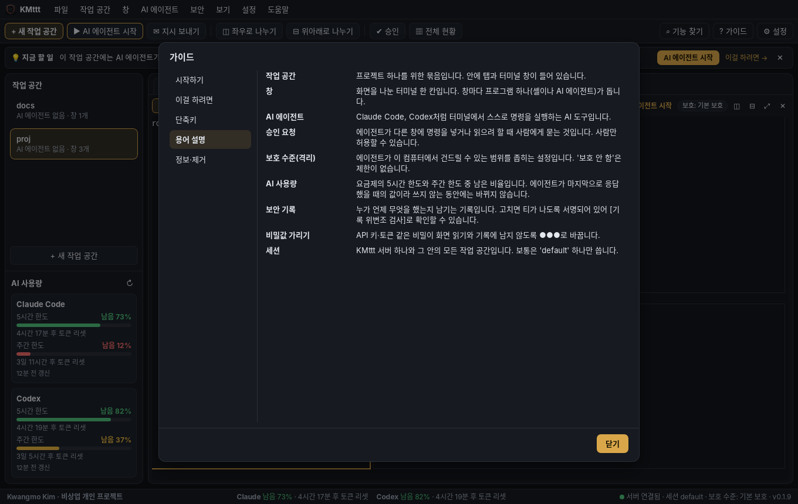

# KMttt Desktop 사용 가이드

> **KMttt는 김광모(Kwangmo Kim)의 비상업 개인 프로젝트입니다.** 회사나 소속 기관의 제품이 아니며, 무료로 배포하고 어떤 보증도 하지 않습니다. 소스 코드 라이선스는 MIT 또는 Apache-2.0입니다(아래 [라이선스와 '비상업'의 뜻](#라이선스와-비상업의-뜻) 참고).

KMttt Desktop은 **AI 코딩 에이전트(Claude Code, Codex 등)를 여러 개 띄워 놓고 한 창에서 지켜보는 프로그램**입니다. 터미널 명령어나 키 조합을 몰라도 마우스로 쓸 수 있고, 에이전트가 위험할 수 있는 일을 하려 하면 사람에게 먼저 묻습니다.

[English guide](USER_GUIDE.md) · [README](../README.ko.md) · [보안 점검 결과](SECURITY-REVIEW.md)

## 목차

1. [설치](#1-설치)
2. [처음 실행](#2-처음-실행)
3. [화면 둘러보기](#3-화면-둘러보기)
4. [자주 하는 일](#4-자주-하는-일)
5. [AI 에이전트 다루기](#5-ai-에이전트-다루기)
6. [승인 요청에 답하기](#6-승인-요청에-답하기)
7. [AI 사용량: 남은 양과 초기화까지 남은 시간](#7-ai-사용량-남은-양과-초기화까지-남은-시간)
8. [통합 관제와 감사 로그](#8-통합-관제와-감사-로그)
9. [설정](#9-설정)
10. [단축키](#10-단축키)
11. [용어집](#11-용어집)
12. [문제 해결](#12-문제-해결)
13. [제거하기](#13-제거하기)
14. [이 프로그램이 하는 일과 하지 않는 일(보안)](#14-이-프로그램이-하는-일과-하지-않는-일보안)

## 1. 설치

[Releases](https://github.com/securidge/securidge-kmttt/releases) 페이지에서 내 컴퓨터에 맞는 파일을 받습니다.

| 컴퓨터 | 받을 파일 | 설치 방법 |
| --- | --- | --- |
| Windows (권장) | `kmttt-desktop-windows-x86_64-setup.exe` | 더블클릭 → 안내(개인 프로젝트·비상업 고지)를 읽고 [동의] → [다음] → [설치] → [마침]. 관리자 권한이 필요 없습니다(내 계정에만 설치). |
| Linux | `kmttt-desktop-linux-x86_64.deb` | `sudo apt install ./kmttt-desktop-linux-x86_64.deb` |
| macOS (Apple Silicon) | `kmttt-desktop-macos-aarch64.app.zip` | 압축을 풀고 응용 프로그램 폴더로 옮긴 뒤, 처음 한 번은 오른쪽 클릭 → [열기]. |

- **Windows "PC 보호" 확인 창(SmartScreen)**: Windows는 새로 나온 프로그램을 처음 실행할 때 확인 창을 띄울 수 있습니다. [추가 정보] → [실행]을 누르면 됩니다. 아래 방법으로 파일이 원본 그대로인지 먼저 확인할 수 있습니다.
- **받은 파일 확인(선택)**: `SHA256SUMS.txt`(모든 파일의 해시)와 그 서명 `SHA256SUMS.txt.minisig`가 함께 올라가 있습니다.
  `minisign -Vm SHA256SUMS.txt -P RWSsN6lcjx/Hn8RG/c/tAQnOC1Xk3A2fOCuRT5mhX7LwEZzT9nYuU80E`로 목록을 확인한 뒤, `Get-FileHash <파일>`(Windows) 또는 `sha256sum -c --ignore-missing SHA256SUMS.txt`로 파일 해시를 비교합니다.
- **명령줄 도구만** 필요하면 `kmttt-<운영체제>-<CPU>` 파일 하나를 받으면 됩니다. KMttt Desktop을 설치하면 이미 들어 있습니다.
- 설치하면 `KMttt Desktop`(창 프로그램)과 `kmttt`(서버·명령줄 도구)가 함께 들어갑니다. 바탕화면과 시작 메뉴에 **KMttt Desktop** 아이콘이 생깁니다.
- 이미 설치되어 있으면 새 설치 파일을 그대로 실행하면 됩니다(업그레이드). KMttt 서버가 돌고 있으면 "서버와 열려 있는 터미널이 종료됩니다"라고 묻습니다.

## 2. 처음 실행

바탕화면의 **KMttt Desktop**을 더블클릭하면 서버가 자동으로 켜지고, 네 단계 안내가 나옵니다. 언제든 [도움말] → [처음 사용 안내 다시 보기]로 다시 볼 수 있습니다.



1. **언어**: 한국어 또는 English. 맨 위에 개인·비상업 프로젝트 고지가 있습니다.
2. **격리 수준**: AI 에이전트가 이 컴퓨터에서 건드릴 수 있는 범위입니다. 아래 표에서 이 컴퓨터에서 실제로 막아 주는 것을 보고 고르세요([9. 설정](#격리-수준) 참고).
3. **프로젝트 폴더**: 에이전트가 일할 폴더를 고릅니다. 그 폴더에서 첫 터미널 창이 열립니다.
4. **첫 AI 에이전트**: 설치되어 있는 에이전트를 고르면 바로 시작합니다. 아직이면 [건너뛰기].

## 3. 화면 둘러보기



| 위치 | 이름 | 하는 일 |
| --- | --- | --- |
| 맨 위 | 메뉴 | 파일 · 워크스페이스 · 창 · AI 에이전트 · 보안 · 보기 · 설정 · 도움말. 모든 기능이 여기 있습니다. |
| 그 아래 | 툴바 | 자주 쓰는 버튼: [에이전트 실행] [워크스페이스] [탭] [오른쪽으로 분할] [아래쪽으로 분할] (아이콘) / 오른쪽 [명령 팔레트] [? 가이드] [⚙ 설정] |
| 상단 막대 | 알림 | 승인 요청, 입력을 기다리는 에이전트, 남은 사용량 부족, 연결 끊김 같은 **지금 봐야 할 일**. 승인 요청이면 자동 거부까지 남은 시간과 [이번만 허용] (Alt+Y) [거부] (Alt+N) [상세 정보] 버튼이 함께 나옵니다. |
| 💡 줄 | 지금 할 일 | 상황에 맞는 한 줄 안내(예: "이 워크스페이스에는 AI 에이전트가 없습니다"). ✕로 숨길 수 있습니다. |
| 왼쪽 위 | 워크스페이스 | 프로젝트 목록. 누르면 그 프로젝트로 바뀝니다. 오른쪽 클릭: 이름 바꾸기·닫기. |
| 왼쪽 아래 | AI 사용량 | Claude·Codex의 **남은 양(%)과 초기화까지 남은 시간**, 그 아래 [현재 토큰 사용량 보기] ([7장](#7-ai-사용량-남은-양과-초기화까지-남은-시간)). 사이드바는 « 버튼이나 Ctrl+B로 접을 수 있습니다. |
| 가운데 | 화면 탭 | 터미널 · 통합 관제 · 승인 · 감사 로그 |
| 가운데 위 줄 | 탭·선택한 창 정보 | 워크스페이스 안의 탭, 선택한 창의 프로그램·격리 수준, 창 버튼(나누기·크게 보기·닫기) |
| 창 위쪽 | 창 제목 줄 | 창마다 이름·종류·상태와 나누기·크게·닫기 버튼. 터미널 글자를 가리지 않도록 서버가 한 줄을 비워 둡니다. |
| 맨 아래 | 상태 줄 | 왼쪽: 저작자 표시(Kwangmo Kim · 비상업 개인 프로젝트), 가운데: 작업 중 · 승인·입력 대기 · 쉬는 중 개수(누르면 그 창으로), 오른쪽: 서버 연결·격리 수준·버전 |

사용법이 궁금하면 **[? 가이드]**(F1)를 누르세요. 시작하기, 작업별 안내, 단축키, 용어집, 정보·제거가 한곳에 있습니다.



하고 싶은 기능의 이름만 알면 **[명령 팔레트]**(Ctrl+Shift+P)에 "나누기", "승인", "사용량"처럼 입력해 바로 실행할 수 있습니다.

## 4. 자주 하는 일

| 하고 싶은 일 | 이렇게 하세요 | 단축키 |
| --- | --- | --- |
| 프로젝트 열기 | [새 워크스페이스] → [찾아보기…]로 폴더 고르기 → 격리 수준 고르기 → [만들기] | Ctrl+Shift+N |
| AI 에이전트 띄우기 | [에이전트 실행] → 종류(Claude Code·Codex 등) → 이름 → [시작] | Ctrl+Shift+A |
| 화면 나누기 | [오른쪽으로 분할] / [아래쪽으로 분할], 또는 창에서 오른쪽 클릭 | Alt+Shift+= / Alt+Shift+- |
| 창 크기 바꾸기 | 두 창 사이 경계선을 마우스로 끌기(두 번 누르면 반반) | Ctrl+Alt+= / Ctrl+Alt+- |
| 모든 창 크기 같게 | [창] 메뉴 또는 창 오른쪽 클릭 | Ctrl+Alt+0 |
| 창 위치 옮기기 | 창 제목 줄을 끌어 다른 창 위에 놓기. 가운데에 놓으면 자리 바꾸기, 가장자리에 놓으면 그쪽에 붙이기, Esc로 취소 | 옆 창과 자리 바꾸기: Ctrl+Alt+Shift+방향키 |
| 창 하나만 크게 보기 | 창 제목 줄의 ⤢ 또는 제목 줄 두 번 누르기, 다시 누르면 되돌림 | Ctrl+Shift+Z |
| 창 닫기 | 창 정보 줄의 ✕ → [창 닫기] | Ctrl+Shift+W |
| 탭 추가 | 탭 줄의 [+] | Ctrl+Shift+T |
| 복사·붙여넣기 | 끌어서 선택 → Ctrl+Shift+C / Ctrl+Shift+V(Windows는 Ctrl+V도), 또는 오른쪽 클릭 | |
| 에이전트에게 지시 | [✉ 프롬프트 전송] → 에이전트 고르기 → 내용 → [보내기] | Ctrl+Shift+I |
| 승인 요청에 답하기 | 알림 막대의 [이번만 허용] / [이 세션 동안 허용] / [거부] (내용을 보려면 [상세 정보]) | Alt+Y / Alt+Shift+Y / Alt+N |
| 모든 에이전트 보기 | [통합 관제] 탭 | Ctrl+Shift+O |
| 글자 크게/작게 | [보기] 메뉴 | Ctrl+= / Ctrl+- |
| 밝은/어두운 화면 | [보기] → [밝은 / 어두운 테마 바꾸기] | — |

Windows에서는 터미널 창을 닫거나, 창의 셸이 끝나거나, KMttt를 끝내면 그 창의 자손 프로세스가 모두 종료됩니다. 창에서 처음 띄운 GUI 앱(VS Code, 로그인 브라우저 등)도 함께 종료됩니다. 계속 쓸 앱은 KMttt 밖에서 열거나 미리 실행해 두세요.

## 5. AI 에이전트 다루기

- **시작**: [에이전트 실행]에서 종류를 고릅니다. 그 프로그램(예: Claude Code의 `claude` 명령)이 이 컴퓨터에 설치되어 있어야 합니다. "지금 창 오른쪽에 새 창을 만들어 시작"을 고르면 화면이 나뉘며 새 창에서 시작합니다.
- **말 걸기**: 에이전트 창을 클릭하고 평소처럼 입력합니다. 다른 화면을 보고 있을 때는 [✉ 프롬프트 전송]로 보낼 수 있습니다.
  - 에이전트가 질문·메뉴를 띄우고 기다리는 중에는 프롬프트 전송을 거부합니다. 보낸 글이 그 질문의 답(메뉴 선택)으로 들어갈 수 있기 때문입니다. 그 창으로 가서 직접 답하세요.
- **상태 표시**: 사이드바, 창 정보 줄, 통합 관제에 에이전트 상태가 나옵니다.

| 표시 | 뜻 | 할 일 |
| --- | --- | --- |
| ● 작업 중 | 에이전트가 일하는 중 | 기다리기 |
| ▲ 입력 대기 | 질문·승인·선택을 기다림 | 알림 막대의 [해당 창으로 이동]로 가서 답하기 |
| ✓ 끝남(확인 전) | 백그라운드에서 일을 마침 | 결과 확인 |
| ○ 대기 | 준비됨, 이미 확인함 | 다음 지시 |
| ? 상태 모름 | 화면으로 판단할 수 없음 | 창을 직접 보기 |

상태가 왜 그렇게 나오는지는 창에서 오른쪽 클릭 → [AI 에이전트 상태가 왜 그런지 보기]로 확인할 수 있습니다.

**Windows PowerShell에서 Codex 실행:** 창에 직접 `codex`를 입력하면 PowerShell이 npm의 `codex.ps1`을 선택해 실행 정책으로 차단할 수 있습니다(`PSSecurityException`). 대신 `codex.cmd`를 입력하거나 **[에이전트 실행] → Codex**를 사용하세요. [에이전트 실행]은 필요한 경우 이미 `.cmd`를 선택하므로 PowerShell 실행 정책을 바꿀 필요가 없습니다.

### Codex 연동(선택)

`kmttt integration install codex`를 실행하면 Codex의 `notify`를 KMttt에 연결하고 KMttt 에이전트 스킬도 설치합니다. 다른 `notify` 설정이 이미 있으면 기본적으로 덮어쓰기를 거부합니다.

기존 설정을 보관하고 교체하려면 `kmttt integration install codex --replace`를 실행하세요. 이때 `config.toml`은 올바른 TOML이어야 하므로, 문법 오류가 있으면 먼저 고치세요. KMttt 연동 중에는 기존 알림 실행이 중단됩니다. Codex 앱의 computer-use처럼 해당 알림에 의존하는 기능도 연동을 해제할 때까지 중단될 수 있습니다.

KMttt 보고 뒤에도 기존 알림을 계속 호출하려면 `kmttt integration install codex --chain`을 명시적으로 선택하세요. 먼저 KMttt 보고를 최대 1초 동안 시도한 뒤, 이전 알림을 별도로 최대 3초 동안 호출합니다. `--chain`을 사용할 때도 올바른 TOML과 기존 알림(또는 앞서 `--replace`로 보관한 알림)이 필요합니다. `--replace`와 함께 지정할 수 없으며, 연결 호출을 다시 끄려면 `kmttt integration install codex --replace`를 실행하세요.

연결 호출은 설치 시 경로를 확인하고 등록한 네이티브 실행 파일만 셸 해석 없이 실행합니다. 셸과 스크립트·`.cmd`/`.bat` 파일을 알림 프로그램으로 직접 지정하면 거부하며, Windows에서는 네이티브 `.exe`가 필요합니다. 이전 알림이 3초 제한을 넘으면 자손 프로세스와 함께 종료됩니다. 이전 알림을 건너뛰거나 실행에 실패하면 `KMttt previous notify skipped or failed` 문구를 출력합니다.

`kmttt integration uninstall codex`로 연동을 해제하면 보관한 알림을 복원합니다. 단, 설치된 KMttt `notify`를 직접 다른 값으로 바꿨다면 현재 설정과 보관한 알림은 그대로 둡니다.

## 6. 승인 요청에 답하기

한 창의 에이전트가 **다른 창**에 명령을 넣거나, 글자를 입력하거나, 내용을 읽으려 하면 KMttt가 먼저 사람에게 묻습니다. 프롬프트 인젝션(에이전트가 읽은 글에 숨은 명령)에 속은 에이전트가 다른 작업을 건드리는 것을 막기 위해서입니다.



- **요청한 쪽**: 어느 워크스페이스의 어느 창(에이전트)이 요청했는지
- **하려는 일**: 예) 다른 창에서 명령 실행 (`pane.run`)
- **대상**: 어느 창에 하려는지
- **내용**: 실제로 넣으려는 명령·글. 민감정보는 마스킹해서 보여 줍니다.

내용을 읽고 [이번만 허용] 또는 [거부]를 누릅니다. 알림 막대에서 바로 답할 수도 있습니다(Alt+Y 허용, Alt+N 거부). 정해진 시간(기본 120초, [설정 → 보안 정책]에서 바꿈) 안에 답하지 않으면 자동으로 거부되며, 남은 시간이 알림 막대와 카드에 초 단위로 보입니다. KMttt가 뒤에 가려져 있으면 Windows 알림으로 알려 주지만, 알림에서는 승인할 수 없고 KMttt에서 내용을 확인해야 합니다. 승인은 **사람이 직접 띄운 KMttt Desktop·터미널 화면**에서만 됩니다. 에이전트의 창 안에서 실행한 프로그램은 승인할 수 없습니다.

### 이 세션 동안 허용

에이전트끼리 대화를 시키면 같은 요청이 계속 올라옵니다. 이때 [이 세션 동안 허용] (Alt+Shift+Y)을 누르면, **같은 에이전트가 같은 창에 같은 작업**을 요청할 때는 더 묻지 않습니다.

- 방향·대상·작업이 하나라도 다르면 다시 묻습니다(예: 반대 방향 대화).
- 식별하지 못한 호출자(`unknown`)는 "이 세션 동안 허용"에서 제외합니다.
- 위험한 도구 호출(훅이 막는 명령)은 이 방식으로 허용할 수 없습니다.
- 관련 창을 닫거나 프로그램(서버)을 끝내면 자동으로 해제됩니다.
- 허용 중인 목록은 [승인] 탭 맨 위에 보이며, [해제]·[모두 해제]로 언제든 되돌릴 수 있습니다.
- 대상 창의 에이전트가 승인 없이 명령을 실행하는 모드(예: Codex의 YOLO 모드)라면, 세션 허용은 그 창을 맡기는 것과 같으니 주의하십시오.

## 7. AI 사용량: 남은 양과 초기화까지 남은 시간

왼쪽 아래 **AI 사용량**에 Claude Code와 Codex 요금제의 남은 양이 나옵니다.

```
Claude Code
  5시간 한도   남음 73%  ████████░░
  4시간 30분 후 토큰 초기화
  주간 한도    남음 12%  █░░░░░░░░░
  3일 11시간 후 토큰 초기화
  4분 전 갱신
```

- **남음 %** = 100 − 쓴 비율. 막대 색: 초록(50% 이상), 노랑(20~50%), 빨강(20% 미만).
- **5시간 한도·주간 한도**: 요금제의 짧은 한도와 긴 한도입니다. 초기화 시각이 지나면 "초기화됨 · 다음 사용 때 갱신"으로 바뀝니다.
- **갱신 시각**: 에이전트가 **마지막으로 응답을 받았을 때의 값**입니다. 에이전트를 쓰지 않는 동안에는 숫자가 바뀌지 않으니 "○분 전 갱신"을 함께 보세요. 초기화까지 남은 시간은 매번 다시 계산합니다.

### Claude Code 연결(처음 한 번)

Claude Code는 남은 사용량을 **공식 상태 줄(statusLine) 입력**으로만 알려 줍니다([Claude Code 문서](https://code.claude.com/docs/en/statusline)). 그래서 한 번 연결해야 합니다.

1. AI 사용량의 Claude Code 칸에서 [연결하기] (또는 [AI 에이전트] 메뉴 → [Claude Claude 사용량 연동])
2. 설명을 읽고 [연결하기]. 기본으로 **상태 감지용 훅도 함께 연결**합니다(권장).
3. Claude Code에서 한 번 응답을 받으면 표시됩니다. Claude Code 아래쪽 줄에도 `5h 23% · 7d 41%`처럼 보입니다.

알아 둘 점:

- **Pro·Max 구독자에게만 나옵니다.** API 키로 쓰면 Claude Code가 사용량을 주지 않습니다.
- 연결하면 `~/.claude/settings.json`의 `statusLine`이 `kmttt statusline`으로 바뀝니다. 원래 파일은 `settings.json.kmttt-backup-<시각>`으로 백업합니다.
- 이미 쓰던 상태 줄이 있으면 묻지 않고 바꾸지 않습니다. "이미 쓰던 상태 줄이 있으면 바꾸기"를 체크해야 바꾸고, 원래 것은 보관했다가 [연결 끊기]나 제거할 때 되돌립니다.
- 사용자 지정 상태 줄이 있으면 Claude Code는 아래쪽 "esc to interrupt" 안내를 숨깁니다. KMttt는 그 문구로도 '작업 중'을 알아보므로 훅을 함께 연결하는 것을 권합니다.
- 로그인 정보(토큰)는 읽지 않습니다. 상태 줄 입력에서 **숫자(사용 비율·초기화 시각)만** `%LOCALAPPDATA%\Securidge\kmttt\usage\claude.json`(Linux `~/.local/share/kmttt/usage/claude.json`)에 저장합니다.

### 현재 토큰 사용량(창별)

[현재 토큰 사용량 보기]를 누르면 터미널 위에 패널이 펼쳐집니다(터미널 크기는 그대로). 다시 누르거나 Esc, 패널 밖을 누르면 닫히고, 닫혀 있는 동안에는 아무것도 읽지 않습니다.



- 위쪽 숫자: Claude Code·Codex 각각 최근 5분의 분당 토큰
- 선 그래프: 최근 15분, 각 점은 그 시점까지 3분 동안의 분당 평균
- 아래 목록: 창마다 최근 5분 평균과 누적 토큰

셈 기준은 **새로 처리한 입력 + 출력 토큰**입니다(캐시에서 다시 읽은 입력은 뺍니다). 값은 응답이 끝날 때마다 늘어나므로 몇 초 간격으로 계단처럼 바뀝니다.

- **Claude Code**: 창마다 대화 기록의 응답별 사용량을 셉니다. 위의 Claude 사용량 연동이 되어 있어야 어느 창의 기록인지 알 수 있습니다.
- **Codex**: 창 정보를 남기지 않으므로 작업 폴더가 같은 최근 Codex 기록과 짝짓습니다(이름 옆 `*`). 같은 폴더에서 Codex 창을 여러 개 쓰면 짝이 바뀔 수 있습니다.
- 남은 사용량(%)은 계정 단위라 같은 종류의 창들이 나눠 씁니다.

남은 양이 15% 아래로 떨어지면 막대가 빨갛게 바뀌고 알림 막대에 한 번 알려 줍니다([닫기]를 누르면 다음 초기화까지 다시 띄우지 않습니다).

### Codex

이 사용량 표시에는 연동이 필요 없습니다. Codex가 남기는 세션 기록(`~/.codex/sessions/**/rollout-*.jsonl`, 압축된 `.jsonl.zst` 포함)의 마지막 사용량 값을 읽습니다. `CODEX_HOME`을 바꿨다면 그 아래 `sessions`를 읽습니다. Codex를 한 번 쓰면 표시됩니다.

명령줄에서는 `kmttt usage`로 같은 값을 JSON으로 볼 수 있습니다.

## 8. 통합 관제와 감사 로그

**통합 관제**(Ctrl+Shift+O)은 모든 워크스페이스의 창을 카드로 보여 줍니다. 입력을 기다리는 에이전트가 맨 앞에 옵니다. 카드마다 상태, 격리 수준, CPU·메모리, 막힌 호출 수, 마지막 줄, [이 창 보기]·[프롬프트 전송]가 있습니다.



**감사 로그**에는 거부된 요청, 의심스러운 지시(프롬프트 인젝션 패턴) 같은 보안 사건이 시간 순서로 나옵니다. [감사 로그 무결성 검증]를 누르면 기록이 고쳐지지 않았는지(해시 체인·서명) 확인합니다.

격리된 창에서 허용 목록에 없는 주소로 나가려는 통신은 막고, 같은 창·같은 주소는 10분에 한 줄로 묶어 '정보' 수준으로 남깁니다. 쓰는 도구(커넥터·플러그인 등)가 필요로 하는 주소라면 그 줄의 [주소 허용]을 눌러 허용 목록에 더할 수 있습니다. 한 창이 짧은 시간에 여러 주소에서 막히면 '주의' 수준으로 한 번 알려 줍니다. Claude Code와 Codex의 로그인·인증·모델 호출 주소는 따로 항상 허용하므로 격리된 창에서도 로그인이 됩니다([설정 → 격리]에서 끌 수 있음).

감사 로그 화면 위쪽에서 심각도(알림·경고·심각), 창, 기간, 내용 검색으로 걸러 볼 수 있고, [내보내기]는 보이는 기록을 CSV로 클립보드에 복사합니다.

## 9. 설정

[⚙ 설정] (Ctrl+,)은 다섯 탭입니다. 저장하면 서버가 바로 다시 읽습니다. 서버가 새 설정을 거부하면 파일을 원래대로 되돌리고 이유를 보여 줍니다. **보안이 약해지는 변경**(예: '확인 요청'→'허용', 제한 격리→격리 없음, 로그 수준 낮추기, 허용 도메인 추가)은 바뀌는 내용을 빨간 글씨로 보여 주고 한 번 더 묻습니다.

| 탭 | 바꿀 수 있는 것 |
| --- | --- |
| 일반 | 언어, 테마, 글꼴 크기, 기본 셸, 화면 공유 모드(화면의 민감정보도 마스킹), 창 내용 일부 복원 |
| 보안 정책 | 에이전트 간 프롬프트 전송·명령 실행·화면 읽기·창 만들기를 [허용/확인 요청/거부], 승인 대기 시간, 분당 호출 수, 추가 규칙 |
| 격리 | 새 창의 기본 격리 수준, 외부 통신 허용 도메인·포트, 메모리·프로세스 수 상한 |
| 감사 로그·마스킹 | 로그 수준(full/metadata/off), 감사 로그 암호화, 다른 파일·syslog로 사본 보내기 |
| 연결·알림 | 세션 이름, 알림 방식, 웹 콘솔에서 승인 허용 |

각 탭 아래의 [설정 파일 직접 편집]으로 `config.toml`·`policy.toml` 원문을 고칠 수도 있습니다. 저장할 때 서버와 같은 규칙으로 검사합니다.



### 격리 수준

| 격리 수준 | Windows | Linux | macOS |
| --- | --- | --- | --- |
| 격리 없음 (none) | 막지 않음 | 막지 않음 | 막지 않음 |
| 제한 격리 (restricted) | **메모리·프로세스 수만 제한. 파일·네트워크는 못 막음** | 프로젝트 밖 쓰기·KMttt 설정·기록 수정 차단, TCP는 허용 목록으로만(커널 6.7+) | KMttt 설정·기록 수정과 외부 통신 차단 |
| 컨테이너 (container) | 프로젝트 폴더만 보임, KMttt 연결 통로 없음 | 같음 | 같음 |
| WSL (wsl) | WSL 리눅스 안에서 실행 | — | — |

Windows에서 에이전트를 확실히 가두려면 `wsl`이나 `container`를 쓰세요(각각 WSL, Docker/Podman이 있어야 합니다).

### KMttt 닫기와 트레이

KMttt 화면의 X 버튼을 누르면 [트레이로 숨기기]와 [프로그램 끝내기] 중 하나를 고릅니다. 터미널 창(pane)을 닫는 [창 닫기]와는 다릅니다.

- **트레이로 숨기기**: KMttt 화면만 숨깁니다. 에이전트는 계속 실행되고, 화면 오른쪽 아래 알림 영역(트레이)의 KMttt 아이콘을 누르면 다시 열립니다.
- **프로그램 끝내기**: KMttt 서버까지 종료합니다. 실행 중인 에이전트도 모두 끝납니다.
- 트레이 아이콘을 마우스 오른쪽 버튼으로 누르면 [KMttt 열기]·[프로그램 끝내기]가 나옵니다.
- 매번 묻지 않게 하려면 [이 선택을 기억]을 체크하거나 [설정 → 일반 → KMttt 닫기 버튼(X)]에서 정합니다.
- KMttt가 트레이에 있을 때 다시 실행하면 새 창이 아니라 기존 창이 열립니다.

## 10. 단축키

| 기능 | 단축키 |
| --- | --- |
| 새 워크스페이스 / 새 탭 | Ctrl+Shift+N / Ctrl+Shift+T |
| 에이전트 실행 / 프롬프트 전송 | Ctrl+Shift+A / Ctrl+Shift+I |
| 좌우로 / 아래쪽으로 분할 | Alt+Shift+= / Alt+Shift+- |
| 창 최대화 / 창 닫기 | Ctrl+Shift+Z / Ctrl+Shift+W |
| 복사 / 붙여넣기 | Ctrl+Shift+C / Ctrl+Shift+V (Windows는 Ctrl+V도) |
| 터미널 / 통합 관제 / 승인 / 감사 로그 | Ctrl+Shift+E / O / Y / L |
| 다음·이전 워크스페이스 | Ctrl+Shift+PageDown / PageUp |
| 설정 / 가이드 / 명령 팔레트 | Ctrl+, / F1 / Ctrl+Shift+P |
| 글자 크게 / 작게 | Ctrl+= / Ctrl+- |

macOS에서는 Ctrl 대신 ⌘를 씁니다.

## 11. 용어집

| 용어 | 뜻 |
| --- | --- |
| 워크스페이스 | 프로젝트 하나를 위한 묶음. 안에 탭과 창이 있습니다. |
| 창(pane) | 화면을 나눈 터미널 한 칸. 창마다 프로그램 하나(셸이나 AI 에이전트)가 돕니다. |
| AI 에이전트 | Claude Code, Codex처럼 터미널에서 스스로 명령을 실행하는 AI 도구 |
| 승인 요청 | 에이전트가 다른 창을 건드리려 할 때 사람에게 묻는 것. 사람만 허용할 수 있습니다. |
| 격리 수준(격리) | 에이전트가 이 컴퓨터에서 건드릴 수 있는 범위를 좁히는 설정 |
| AI 사용량 | 요금제의 5시간·주간 한도 중 남은 비율 |
| 감사 로그 | 누가 언제 무엇을 했는지 남기는 서명된 기록 |
| 민감정보 마스킹(마스킹) | API 키·토큰 같은 비밀을 화면 읽기와 기록에서 ●●●로 바꾸는 것 |
| 세션 | KMttt 서버 하나와 그 안의 모든 워크스페이스. 보통 `default` 하나 |



## 12. 문제 해결

| 증상 | 원인과 해결 |
| --- | --- |
| "KMttt 서버에 연결하지 못했습니다" | [서버 시작]을 누르세요. 그래도 안 되면 `kmttt.exe`가 KMttt Desktop과 같은 폴더에 있는지 확인하세요(포터블). 로그: `%LOCALAPPDATA%\Securidge\kmttt\kmttt-server.log` |
| "보안 정책에 따라 연결이 거부되었습니다" | 앱이 AI 에이전트의 창 안이나 자동화 도구로 실행됐습니다. 바탕화면·시작 메뉴에서 직접 실행하세요. 의도된 보안 동작입니다. |
| Windows "PC 보호" 경고 | [추가 정보] → [실행]. 서명 확인은 [1장](#1-설치) 참고 |
| AI 사용량이 안 보임 | Claude: [연결하기]를 했는지, Pro·Max 요금제인지, 연결 후 Claude Code에서 응답을 한 번 받았는지 확인. Codex: Codex를 한 번 쓴 뒤 [↻] |
| 숫자가 오래된 것 같음 | 마지막 응답 때의 값입니다. "○분 전 갱신"을 보세요. 에이전트를 쓰면 바로 갱신됩니다. |
| 터미널 크기가 이상함 | TUI(`kmttt`)를 동시에 켜 두면 마지막에 크기를 보낸 쪽에 맞춰집니다. 하나만 쓰거나 창 크기를 한 번 바꾸세요. |
| 프롬프트 전송이 거부됨 | 에이전트가 질문·메뉴에서 기다리는 중입니다. 그 창으로 가서 직접 답하세요. |

## 13. 제거하기

**Windows**: 시작 → 설정 → 앱 → 설치된 앱 → **KMttt Desktop** → [제거]. 제거하면 다음 일이 일어납니다.

1. KMttt 서버가 돌고 있으면 "서버와 열려 있는 모든 터미널·AI 에이전트가 종료됩니다"라고 묻고, [확인]을 누르면 끕니다.
2. 이 설치본이 Claude Code·Codex 설정에 등록한 **훅과 상태 줄을 지웁니다.** 다른 위치에 설치한 `kmttt`가 등록한 것은 그대로 둡니다. 원래 쓰던 Claude 상태 줄은 되돌립니다.
3. 프로그램 파일과 바로 가기를 지웁니다.
4. **설정(보안 정책 포함)과 감사 로그도 지울지** 묻습니다. 기본은 [아니요] (남김)입니다. 감사 로그는 나중에 무슨 일이 있었는지 확인할 증거이기 때문입니다. 남긴 파일 위치: `%APPDATA%\Securidge\kmttt`, `%LOCALAPPDATA%\Securidge\kmttt`

**포터블(zip)**: 먼저 KMttt Desktop의 [파일] → [서버 종료]를 누르고, 명령 프롬프트에서 `kmttt.exe uninstall --yes`(훅과 설정을 지우고 감사 로그는 남김. `--purge-ledger`를 붙이면 기록도 지움)를 실행한 뒤 폴더를 지우세요.

**Linux**: `kmttt uninstall --yes`로 훅·설정을 정리한 뒤 `sudo apt remove k-mttt-desktop`(패키지 이름은 빌드 도구가 만든 것입니다).

## 14. 이 프로그램이 하는 일과 하지 않는 일(보안)

- 모든 판단(승인, 보안 정책, 격리 수준, 기록, 민감정보 마스킹)은 KMttt 서버가 합니다. 데스크톱 앱은 터미널 화면(TUI)과 같은 권한만 가진 "사람용 화면"입니다.
- 앱 안의 화면은 앱에 들어 있는 파일만 읽습니다. 인터넷에서 스크립트를 받아 실행하지 않습니다.
- 앱은 다른 창에 몰래 명령을 넣는 기능(`pane.run`, `pane.send`, `pane.read`)을 쓰지 않습니다. 사람이 직접 입력한 키만 보냅니다.
- 터미널 속 링크는 주소 전체를 보여 주고 확인을 받은 뒤 `http`·`https`만 엽니다.
- **격리 수준 고르기**: '격리 없음'에서 같은 Windows 사용자 권한으로 도는 에이전트가 작정하고 우회하는 것(예: OS 자동화로 [이번만 허용] 버튼 누르기)은 보호 범위 밖이며, 기록에는 남습니다. 믿지 못하는 에이전트는 `container`나 `wsl`로 돌리세요.

자세한 점검 결과는 [보안 점검 결과](SECURITY-REVIEW.md)에 있습니다.

### 라이선스와 '비상업'의 뜻

'비상업 개인 프로젝트'는 **이 프로그램을 판매하거나 유료로 제공하지 않는다**는 뜻입니다. 소스 코드는 MIT 또는 Apache-2.0 라이선스로 공개되어 있으며, 이 라이선스 조건 안에서는 누구나 쓸 수 있습니다. 어떤 보증도 하지 않습니다.
