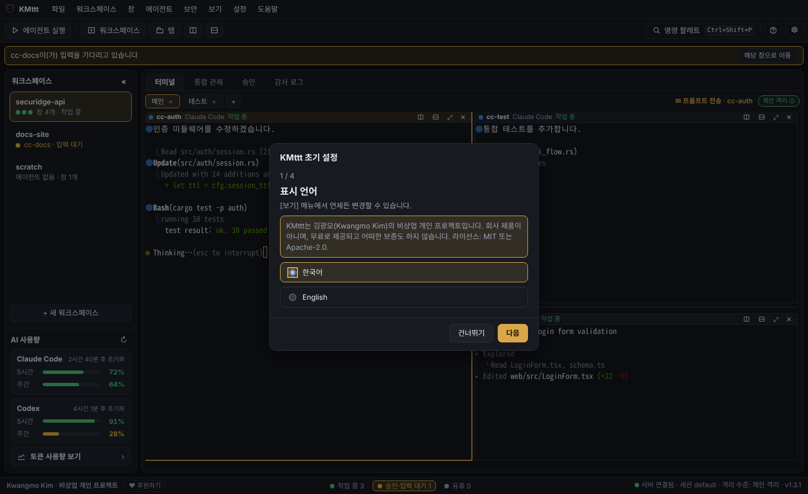
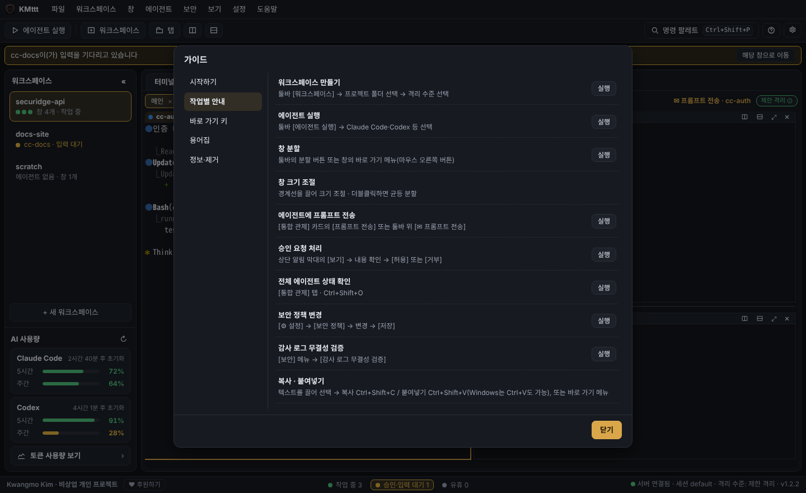
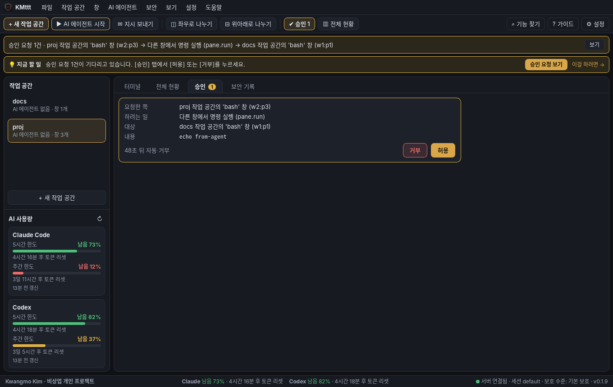
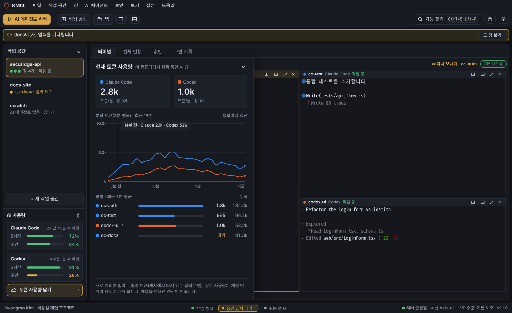
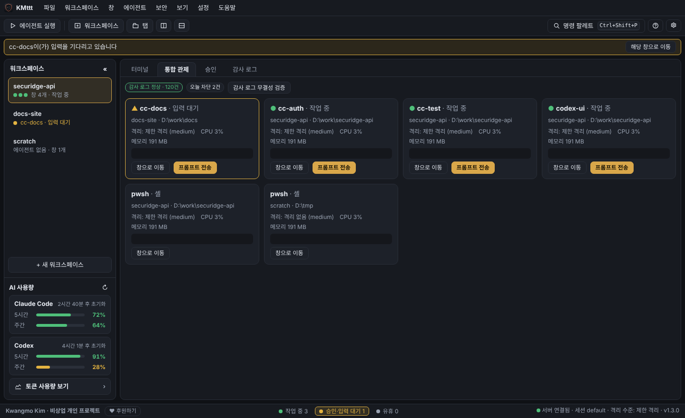
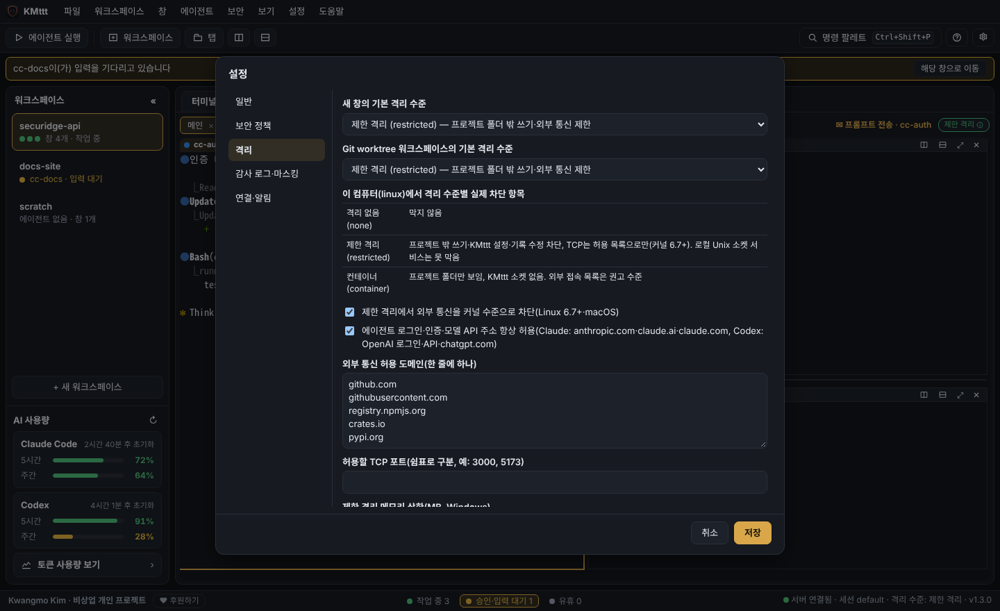

# KMttt Desktop user guide

> **KMttt is a non-commercial personal project by Kwangmo Kim (김광모).** It is not a product of any employer or organization, it is distributed free of charge, and it comes with no warranty. The source code is licensed under MIT or Apache-2.0 (see [License and "non-commercial"](#license-and-non-commercial)).

KMttt Desktop lets you **run several AI coding agents (Claude Code, Codex, …) side by side and watch them in one window**. You can use it with the mouse, without learning terminal commands or key bindings, and it asks a person before an agent does something risky.

[한국어 가이드](USER_GUIDE.ko.md) · [README](../README.md) · [Security review](SECURITY-REVIEW.md)

## Contents

1. [Install](#1-install)
2. [First run](#2-first-run)
3. [A tour of the window](#3-a-tour-of-the-window)
4. [Common tasks](#4-common-tasks)
5. [Working with AI agents](#5-working-with-ai-agents)
6. [Answering approval requests](#6-answering-approval-requests)
7. [AI usage: what is left and when it resets](#7-ai-usage-what-is-left-and-when-it-resets)
8. [Control center and audit log](#8-control-center-and-audit-log)
9. [Settings](#9-settings)
10. [Keyboard shortcuts](#10-keyboard-shortcuts)
11. [Glossary](#11-glossary)
12. [Troubleshooting](#12-troubleshooting)
13. [Uninstall](#13-uninstall)
14. [What the app does and does not do (security)](#14-what-the-app-does-and-does-not-do-security)

## 1. Install

Download the file for your computer from [Releases](https://github.com/securidge/securidge-kmttt/releases).

| Computer | File | How |
| --- | --- | --- |
| Windows (recommended) | `kmttt-desktop-windows-x86_64-setup.exe` | Double-click → read the notice (personal, non-commercial project) and accept → Next → Install → Finish. No administrator rights needed (installs for your account only). |
| Linux | `kmttt-desktop-linux-x86_64.deb` | `sudo apt install ./kmttt-desktop-linux-x86_64.deb` |
| macOS (Apple Silicon) | `kmttt-desktop-macos-aarch64.app.zip` | Unzip, move to Applications, then right-click → Open the first time. |

- **Windows SmartScreen prompt**: Windows may ask for confirmation the first time you run a newly published program. Choose More info → Run anyway. You can verify the file first as shown below.
- **Verify a download (optional)**: `SHA256SUMS.txt` (the hash of every file) and its signature `SHA256SUMS.txt.minisig` are on the release page.
  Check the list with `minisign -Vm SHA256SUMS.txt -P RWSsN6lcjx/Hn8RG/c/tAQnOC1Xk3A2fOCuRT5mhX7LwEZzT9nYuU80E`, then compare the file hash with `Get-FileHash <file>` (Windows) or `sha256sum -c --ignore-missing SHA256SUMS.txt`.
- **Command-line tool only**: download the one `kmttt-<os>-<cpu>` file. KMttt Desktop already includes it.
- Installing adds `KMttt Desktop` (the window app) and `kmttt` (the server and command-line tool), plus a **KMttt Desktop** shortcut on the desktop and in the Start menu.
- To upgrade, run the new installer. If a KMttt server is running it asks first, because the server and open terminals will be stopped.

## 2. First run

Double-click **KMttt Desktop**. The server starts by itself and a four-step setup appears. Reopen it any time from Help → Show the first-run setup again.



1. **Language** — Korean or English. The notice at the top says this is a non-commercial personal project.
2. **Isolation level** — how much of this computer an agent can reach. The table shows what each level actually blocks on this computer (see [Isolation levels](#isolation-levels)).
3. **Project folder** — the first terminal pane opens there.
4. **First AI agent** — pick an installed agent to start it now, or Skip.

## 3. A tour of the window


| Where | Name | What it does |
| --- | --- | --- |
| Top | Menu | File · Workspace · Panes · AI agents · Security · View · Settings · Help. Every feature is here. |
| Below it | Toolbar | [Launch agent] [Workspace] [Tab] [Split left/right] [Split top/bottom] (icons), and on the right [Command palette] [? Guide] [⚙ Settings] |
| Top banner | Alerts | What needs you now: approval requests, agents waiting for input, low remaining usage, a lost connection. For an approval request it shows the seconds left before automatic denial and [Allow] (Alt+Y) [Deny] (Alt+N) [Details]. |
| 💡 line | Do this now | A one-line hint for the current situation. ✕ hides it. |
| Top left | Workspaces | Your projects. Click to switch; right-click to rename or close. |
| Bottom left | AI usage | How much Claude and Codex usage is left and **when it resets**, with [Show current token usage] below ([section 7](#7-ai-usage-what-is-left-and-when-it-resets)). Collapse the sidebar with « or Ctrl+B. |
| Center | View tabs | Terminal · Control center · Approvals · Audit log |
| Above the panes | Tabs and pane info | The workspace's tabs, the selected pane's program and protection, pane buttons (split, enlarge, close) |
| Top of each pane | Pane title row | Name, kind and state of the pane, with split, enlarge and close buttons. The server leaves one row for it so it never covers terminal text. |
| Bottom | Status bar | Left: credit (Kwangmo Kim · non-commercial personal project). Middle: how many agents are working, waiting for you and idle (click to go there). Right: connection, protection, version |

Press **[? Guide]** (F1) for getting started, how-tos, shortcuts, a glossary, and about/uninstall. If you know what you want to do but not where it is, press **[Command palette]** (Ctrl+Shift+P) and type "split", "approve", "usage", …



## 4. Common tasks

| To do this | Do this | Shortcut |
| --- | --- | --- |
| Open a project | [+ New workspace] → [Browse…] → pick a isolation level → [Create] | Ctrl+Shift+N |
| Launch an agent | [Launch agent] → pick the agent → name → [Start] | Ctrl+Shift+A |
| Split the screen | [Split left/right] / [Split top/bottom], or right-click a pane | Alt+Shift+= / Alt+Shift+- |
| Resize panes | Drag the line between two panes (double-click to split evenly) | Ctrl+Alt+= / Ctrl+Alt+- |
| Make all panes the same size | [Pane] menu or right-click a pane | Ctrl+Alt+0 |
| Move a pane | Drag its title row onto another pane: the center swaps the two, an edge places it on that side, Esc cancels | Swap with the neighbor: Ctrl+Alt+Shift+arrow |
| Enlarge one pane | ⤢ in the title row or double-click the title row; again to restore | Ctrl+Shift+Z |
| Close a pane | ✕ in the pane info line → [Close pane] | Ctrl+Shift+W |
| New tab | [+] in the tab line | Ctrl+Shift+T |
| Copy and paste | Drag to select → Ctrl+Shift+C / Ctrl+Shift+V (also Ctrl+V on Windows), or right-click | |
| Instruct an agent | [✉ Send prompt] → agent → text → [Send] | Ctrl+Shift+I |
| Answer an approval | [Allow] / [Allow for this session] / [Deny] on the approval banner ([Details] to read more) | Alt+Y / Alt+Shift+Y / Alt+N |
| See every agent | [Control center] tab | Ctrl+Shift+O |
| Larger / smaller text | View menu | Ctrl+= / Ctrl+- |

On Windows, when a pane closes, its shell exits or you quit KMttt, all of that pane's descendant processes end too, including GUI apps first launched from it (such as VS Code or a browser opened for sign-in). Open apps you want to keep using outside KMttt, or start them before you open them from a pane.

## 5. Working with AI agents

- **Start**: [Launch agent] and pick one. The program must be installed (Claude Code needs the `claude` command). "In a new pane to the right" splits the screen and starts it there.
- **Talk to it**: click its pane and type. From another view, use [✉ Send prompt].
  - If the agent is waiting on a question or menu, Send prompt refuses, because your text would become the answer (a menu choice). Go to its pane and answer it yourself.
- **States**:

| Shown | Meaning | What to do |
| --- | --- | --- |
| ● working | The agent is working | Wait |
| ▲ waiting for input | It is waiting for an answer, approval or choice | Use [Go to pane] on the banner and answer |
| ✓ done (unseen) | It finished in the background | Check the result |
| ○ idle | Ready, already seen | Give the next instruction |
| ? unknown | The screen does not tell | Look at the pane |

Right-click a pane → "Why is the agent in this state?" shows the evidence.

**Codex in Windows PowerShell:** if you type `codex` directly in a pane, PowerShell may select npm's `codex.ps1` and block it under its execution policy (`PSSecurityException`). Run `codex.cmd` instead, or use **[Launch agent] → Codex**, which already selects the `.cmd` launcher when needed. You do not need to change PowerShell's execution policy.

### Optional Codex integration

Run `kmttt integration install codex` to connect Codex's `notify` to KMttt and install the KMttt agent skill. If another `notify` setting already exists, the command refuses to overwrite it by default.

To save and replace that setting, run `kmttt integration install codex --replace`. `config.toml` must be valid TOML for this; fix any syntax errors first. The previous notifier is disabled while the KMttt integration is installed. Features that depend on it, such as computer use in the Codex app, may stop until you remove the integration.

To keep calling the previous notifier after KMttt reporting, explicitly opt in with `kmttt integration install codex --chain` instead. KMttt reporting is attempted first with a 1-second limit, followed by a separate 3-second limit for the previous notifier. `--chain` also requires valid TOML and an existing notifier (or one saved by an earlier `--replace` install). It cannot be combined with `--replace`; to disable chaining again, run `kmttt integration install codex --replace`.

Chaining runs only the native executable whose path was resolved and registered during installation, without shell interpretation. Shells and scripts, including `.cmd`/`.bat` files, are rejected as the notifier program; Windows requires a native `.exe`. A notifier that exceeds its 3-second limit is terminated along with its descendants. A skipped or failed previous notifier is reported as `KMttt previous notify skipped or failed`.

Run `kmttt integration uninstall codex` to remove the integration and restore the saved notifier. If you have replaced KMttt's installed `notify` yourself, removal leaves your current setting and the saved notifier unchanged.

## 6. Answering approval requests

When an agent in one pane tries to run a command in, type into, or read **another pane**, KMttt asks a person first. This stops an agent that was tricked by a prompt injection from tampering with your other work.



The card shows who asked (which pane in which workspace), what it wants to do (for example "Run a command in another pane", `pane.run`), the target pane, and the exact text (secrets masked). Press [Allow] or [Deny], or answer straight from the approval banner (Alt+Y allow, Alt+N deny). Unanswered requests are denied after the timeout (120 seconds by default, change it in Settings → Security policy); the banner and the card count down the seconds left. If KMttt is behind other windows, a Windows notification tells you, but you cannot approve from the notification: review the request in KMttt. Only a KMttt window that a person started can approve; a program started inside an agent's pane cannot.

### Allow for this session

When agents talk to each other, the same request keeps coming back. Press [Allow for this session] (Alt+Shift+Y) and **the same agent asking the same pane for the same action** is no longer asked about.

- A different direction, target or action asks again.
- Unidentified callers (`unknown`) are excluded from "Allow for this session".
- Dangerous tool calls blocked by hooks cannot be allowed this way.
- It ends automatically when a related pane closes or the program (server) quits.
- Active session approvals are listed at the top of the Approvals tab; [Revoke] or [Revoke all] undoes them any time.
- If the target agent runs commands without its own approvals (for example Codex in YOLO mode), a session approval effectively hands that pane over.

## 7. AI usage: what is left and when it resets

**AI usage** at the bottom left shows how much of your Claude Code and Codex plan is left.

```
Claude Code
  5-hour limit   73% left  ████████░░
  Resets in 4h 30m
  Weekly limit   12% left  █░░░░░░░░░
  Resets in 3d 11h
  updated 4m ago
```

- **% left** = 100 − used. Bar colors: green (50% or more), yellow (20–50%), red (under 20%).
- After the reset time passes it shows "Reset · updates on next use".
- The numbers are from the agent's **last response**; they do not change while you are not using it. The countdown is recalculated every time.

### Connecting Claude Code (once)

Claude Code reports usage only through the input of its **official status line** ([docs](https://code.claude.com/docs/en/statusline)), so connect it once:

1. Press [Connect] in the Claude Code box (or AI agents menu → Connect Claude usage display).
2. Read the explanation and press [Connect]. By default it also connects the **state hooks** (recommended).
3. It shows after Claude Code's next response. Claude Code's bottom line also shows `5h 23% · 7d 41%`.

Things to know:

- **Only for Claude Pro and Max subscribers.** With an API key, Claude Code does not provide usage.
- Connecting sets `statusLine` in `~/.claude/settings.json` to `kmttt statusline`; the original file is backed up as `settings.json.kmttt-backup-<time>`.
- If you already have your own status line, KMttt does not replace it unless you tick "Replace my existing status line"; yours is kept and restored on Disconnect or uninstall.
- With a custom status line, Claude Code hides its "esc to interrupt" hint, which KMttt also uses to detect "working". Connect the hooks too.
- KMttt never reads your login. It stores **only the numbers** (used % and reset time) in `%LOCALAPPDATA%\Securidge\kmttt\usage\claude.json` (Linux: `~/.local/share/kmttt/usage/claude.json`).

### Current token usage (per pane)

Press [Show current token usage] to open a panel over the terminal (the terminal keeps its size). Press it again, press Esc or click outside to close it; while it is closed nothing is read.



- Top numbers: tokens per minute over the last 5 minutes, for Claude Code and for Codex
- Line chart: the last 15 minutes; each point is the per-minute average over the 3 minutes before it
- List: each pane's last-5-minute average and its total

What is counted: **new input plus output tokens** (input re-read from cache is not counted). Values grow when a response finishes, so they move in steps every few seconds.

- **Claude Code**: counts per-response usage in each pane's conversation log. The usage display connection above is what tells KMttt which log belongs to which pane.
- **Codex**: Codex does not record which pane it runs in, so KMttt pairs each Codex pane with the latest Codex log from the same folder (marked `*`). With several Codex panes in one folder the pairing can swap.
- Remaining usage (%) is per account, so panes of the same kind share it.

When less than 15% is left the bar turns red and the approval banner tells you once ([Dismiss] hides it until the next reset).

### Codex

No integration is needed for this usage display. KMttt reads the latest usage sample from Codex's session logs (`~/.codex/sessions/**/rollout-*.jsonl`, including compressed `.jsonl.zst`; under `$CODEX_HOME` if set). It shows after you use Codex once.

`kmttt usage` prints the same data as JSON.

## 8. Control center and audit log

**Control center** (Ctrl+Shift+O) shows every pane as a card, agents waiting for input first, with state, isolation level, CPU and memory, blocked calls, the last line, and [Show pane] / [Send prompt].



**Audit log** lists denied requests, suspicious instructions (prompt-injection patterns) and other security events. [Verify audit log integrity] verifies the log's hash chain and signatures.

Isolated panes cannot connect to addresses outside the allow list. Repeats from the same pane to the same address are grouped into one Info line every 10 minutes. If a tool you use (a connector, plugin and so on) needs that address, click [Allow address] on the line to add it to the allow list. A pane blocked on many different addresses in a short time gets one Caution entry. Claude Code and Codex sign-in, authentication and model addresses are always allowed, so signing in works in isolated panes (you can turn this off in Settings → Isolation).

At the top of the audit log you can filter by severity (info, warning, critical), pane, time range and text; [Export] copies the visible rows to the clipboard as CSV.

## 9. Settings

[⚙ Settings] (Ctrl+,) has five tabs. Saving reloads the server right away; if the server rejects the new settings, the file is restored and the reason is shown. **Changes that weaken security** (Ask → Allow, Restricted isolation → No isolation, a lower log level, new allowed domains) are listed in red and confirmed again.

| Tab | What you can change |
| --- | --- |
| General | Language, theme, font size, default shell, screen-sharing mode, restoring some pane text after a restart |
| Security policy | Allow / Ask / Deny for agents sending prompts to each other, running commands in other panes, reading other panes, creating panes; approval timeout; calls per minute; extra rules |
| Isolation | Default isolation level for new panes, allowed domains and ports, memory and process limits |
| Audit log & masking | Log level (full / metadata / off), encryption, copies to another file or syslog |
| Connection & alerts | Session name, notifications, approve/deny from the web console |

[Edit settings file] opens the raw `config.toml` / `policy.toml`; saving runs the same checks as the server.



### Isolation levels

| Level | Windows | Linux | macOS |
| --- | --- | --- | --- |
| No isolation (none) | Blocks nothing | Blocks nothing | Blocks nothing |
| Restricted isolation (restricted) | **Limits memory and process count only; does not block files or network** | Blocks writes outside the project and edits to KMttt config/log; TCP only via the allow list (kernel 6.7+) | Blocks edits to KMttt config/log and outbound connections |
| Container (container) | Sees only the project folder, no KMttt socket | same | same |
| WSL (wsl) | Runs inside WSL Linux | — | — |

On Windows, use `wsl` or `container` to really contain an agent (they need WSL or Docker/Podman).

### Closing the window and the tray

The window's X button asks whether to [Close window] or [Quit].

- **Close window** hides the window. Agents keep running; click the KMttt icon in the notification area (tray) to bring it back.
- **Quit** stops the KMttt server too, which ends every running agent.
- Right-click the tray icon for [Open KMttt] and [Quit].
- Check [Remember my choice] or set it in Settings → General → Close button (X) to stop the question.
- Starting KMttt again while it sits in the tray brings back the existing window instead of opening a second one.

## 10. Keyboard shortcuts

| Feature | Shortcut |
| --- | --- |
| New workspace / new tab | Ctrl+Shift+N / Ctrl+Shift+T |
| Launch agent / send prompt | Ctrl+Shift+A / Ctrl+Shift+I |
| Split left/right / top/bottom | Alt+Shift+= / Alt+Shift+- |
| Enlarge pane / close pane | Ctrl+Shift+Z / Ctrl+Shift+W |
| Copy / paste | Ctrl+Shift+C / Ctrl+Shift+V (also Ctrl+V on Windows) |
| Terminal / Control center / Approvals / Audit log | Ctrl+Shift+E / O / Y / L |
| Next / previous workspace | Ctrl+Shift+PageDown / PageUp |
| Settings / Guide / Command palette | Ctrl+, / F1 / Ctrl+Shift+P |
| Larger / smaller text | Ctrl+= / Ctrl+- |

On macOS use ⌘ instead of Ctrl.

## 11. Glossary

| Term | Meaning |
| --- | --- |
| Workspace | One group for a project, holding tabs and panes |
| Pane | One terminal area of the split screen, running one program (a shell or an AI agent) |
| AI agent | An AI tool such as Claude Code or Codex that runs commands in a terminal by itself |
| Approval request | KMttt asking a person before an agent touches another pane |
| Isolation level (isolation) | How much of this computer an agent can reach |
| AI usage | How much of your plan's 5-hour and weekly limits is left |
| Audit log | A signed record of who did what and when |
| Secret masking | Replacing API keys and tokens with ●●● in pane reads and the log |
| Session | One KMttt server and all its workspaces; usually `default` |

## 12. Troubleshooting

| Problem | Cause and fix |
| --- | --- |
| "Could not connect to the KMttt server" | Press [Start server]. Log: `%LOCALAPPDATA%\Securidge\kmttt\kmttt-server.log` |
| "The connection was refused by the security rules" | The app was started inside an agent's pane or by an automation tool. Start it yourself from the desktop or Start menu. This is intended. |
| SmartScreen warning | More info → Run anyway. See [Install](#1-install) to verify the file. |
| AI usage is empty | Claude: did you Connect, are you on Pro/Max, has Claude Code answered once since? Codex: use it once, then press ↻. |
| Numbers look old | They are from the last response; check "updated … ago". |
| Terminal size looks wrong | With the terminal UI (`kmttt`) open at the same time, the last client to send a size wins. Use one, or resize the window once. |
| Send prompt refused | The agent is waiting on a question or menu. Answer it in its pane. |

## 13. Uninstall

**Windows**: Start → Settings → Apps → Installed apps → **KMttt Desktop** → Uninstall. This:

1. Asks before stopping a running KMttt server (and every open terminal and agent).
2. Removes the **hooks and status line this copy registered** in Claude Code and Codex, leaving entries made by a `kmttt` installed elsewhere, and restores your own Claude status line.
3. Removes the program files and shortcuts.
4. Asks whether to **delete settings (including security rules) and the audit log**. The default is No (keep), because the log is evidence you may need later. Kept in `%APPDATA%\Securidge\kmttt` and `%LOCALAPPDATA%\Securidge\kmttt`.

**Portable zip**: File → Stop server in the app, run `kmttt.exe uninstall --yes` (removes hooks and settings, keeps the audit log; add `--purge-ledger` to delete it too), then delete the folder.

**Linux**: run `kmttt uninstall --yes`, then `sudo apt remove k-mttt-desktop` (the package name is generated by the build tool).

## 14. What the app does and does not do (security)

- Every decision (approvals, rules, protection, the log, masking) is made by the KMttt server. The desktop app is a human client with the same rights as the terminal UI.
- The app's screens load only files built into the app; it never runs scripts from the internet.
- The app does not use the methods that type into or read other panes behind your back (`pane.run`, `pane.send`, `pane.read`); it sends only keys you type.
- Links inside terminals show the full address and ask before opening, and only `http`/`https` are allowed.
- **Choosing a isolation level**: in "No isolation", an agent running as the same Windows user that deliberately attacks KMttt (for example by clicking [Allow] through OS automation) is outside what KMttt contains; the log still records it. Run untrusted agents in `container` or `wsl`.

Details: [Security review](SECURITY-REVIEW.md).

### License and "non-commercial"

"Non-commercial personal project" means **this program is not sold or offered as a paid service**. The source code is published under MIT or Apache-2.0, and anyone may use it under those license terms. There is no warranty.
